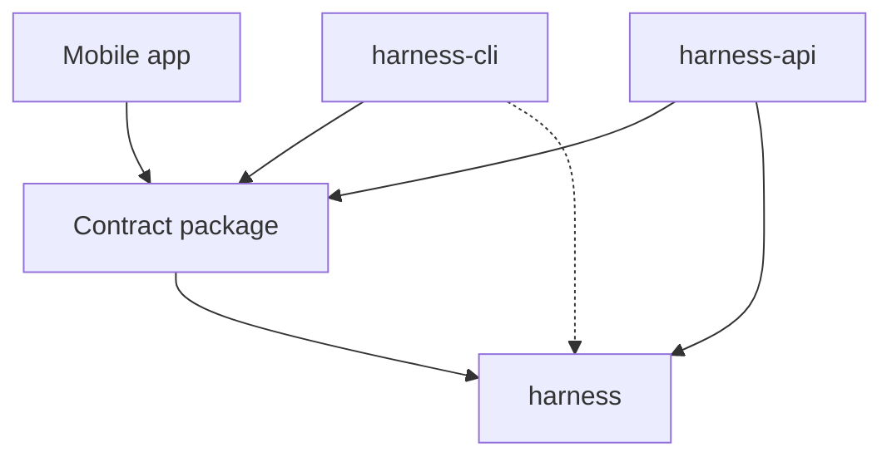

# harness-docs

The design of the MiKode harness product, across its projects.

## The product

MiKode is one personal place for conversations with agents. The user starts work from a CLI,
turns off the laptop while execution continues on a server, and continues the same
conversation from a mobile app. The user can change agents or supported models without
copying the conversation history between products. [`mvp.md`](mvp.md) holds the scope and the
requirements.

The product has not been built yet. These documents define the target; each project's own
`docs/architecture.md` describes what that project is today.

## The projects

An arrow means "depends on".



The dotted arrow is today's dependency of the CLI, which runs agents on the user's machine.
It ends when the CLI talks to the API.

- `harness` (`@mikode13/harness`, [github.com/Mikode13/harness](https://github.com/Mikode13/harness)):
  the library that runs agents. It knows nothing about any other project.
- The contract package (not created yet, name not decided): only types, for the product's
  state events. It depends on the harness. The API and the clients depend on it.
- `harness-api` ([github.com/Mikode13/harness-api](https://github.com/Mikode13/harness-api)):
  the server. It depends on the harness and on the contract package. Today it is a scaffold.
- `harness-cli` ([github.com/Mikode13/harness-cli](https://github.com/Mikode13/harness-cli)):
  the terminal client. It will depend on the contract package and talk to the API
  ([harness-cli#18](https://github.com/Mikode13/harness-cli/issues/18)). Today it depends on
  the harness and runs agents on the user's machine.
- The mobile app (not started; [harness-api#13](https://github.com/Mikode13/harness-api/issues/13)):
  a client, like the CLI.
- `harness-docs`: this repository. Nothing depends on it; the other repositories link to it.
- `engineering` ([github.com/Mikode13/engineering](https://github.com/Mikode13/engineering)):
  cross-project engineering standards. It is how the projects are built, not what the product
  is.

Every dependency points towards the harness, and the harness depends on none of them.

## Where a document lives

A document lives with the owner of what it describes. The test: if the document would still
be true after deleting a repository, it does not belong to that repository.

Product-level documents are here: scope, glossary, flows, design, and the decisions and
learnings that cross projects. Each code repository keeps its own `docs/architecture.md`,
`docs/decisions.md` and `docs/learnings.md`, about how that repository is built, and links
here, never the reverse. The harness's documents never describe the product.

## Layout

- [`mvp.md`](mvp.md): the scope and the requirements of the MVP.
- [`glossary.md`](glossary.md): the words the product uses for its parts.
- `flows/`: one file per flow, with its diagram; [`flows/README.md`](flows/README.md) lists
  them.
- `design/`: the design documents: [`run-lifecycle.md`](design/run-lifecycle.md),
  [`events.md`](design/events.md), [`security.md`](design/security.md) and
  [`harness-needs.md`](design/harness-needs.md).
- [`docs/decisions.md`](docs/decisions.md): the product's decisions, which cross its
  projects.
- [`docs/learnings.md`](docs/learnings.md): what designing, building or running the product
  taught, with its evidence.
- [`docs/architecture.md`](docs/architecture.md): how this repository itself is organized.
- [`AGENTS.md`](AGENTS.md): how an agent uses and updates this repository.

## Checks

```sh
pnpm install --frozen-lockfile
pnpm run docs:check
```

The checks cover formatting, Markdown structure and internal links. External URLs are not
checked.

## License

The documentation in this repository is licensed under the
[Creative Commons Attribution 4.0 International License](LICENSE) (CC BY 4.0). The software
projects it describes have their own licenses.
