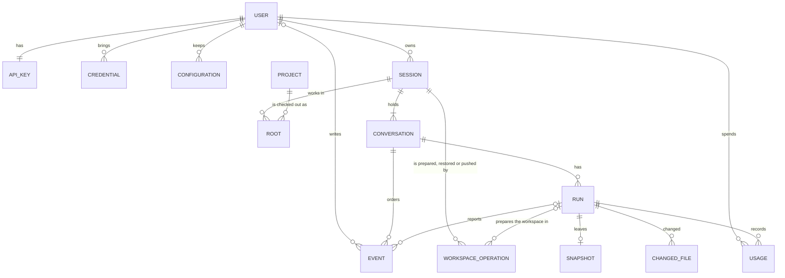

# Data model

What the API keeps, how the parts relate, and what the model leaves room for. This is the
conceptual model: the entities and their relations, not tables. The tables, their columns,
indexes and migrations belong to harness-api, which is the only writer of its database. The
terms are in the [glossary](../glossary.md). None of it is built yet.

The maintainer set its shape on 2026-11-19. Much of it follows from the flows and the other
design documents, which this document links rather than repeats.

The CLI used locally keeps its own store, without the API, and it is not designed here; see
[harness-cli#21](https://github.com/Mikode13/harness-cli/issues/21). The harness stores
nothing: it gives its consumers events and a snapshot, and each stores what it needs.

## The entities

Every entity has an id of its own. The ids a client generates, a session's and a prompt's,
are unique only within their user, so a session or a prompt is known by its user and its id;
anything named after a session's id, such as the provisional name of its branch, includes its
user too. See [authenticate](../flows/authenticate.md).

| Entity              | What it is                                                                                                                                                          | Where it is decided                                                            |
| ------------------- | ------------------------------------------------------------------------------------------------------------------------------------------------------------------- | ------------------------------------------------------------------------------ |
| User                | A person who may use the product. An id and an optional name.                                                                                                       | [Users and keys](#users-and-keys)                                              |
| API key             | The key a user's requests carry. One per user, kept as a hash, and it can be disabled.                                                                              | [security](security.md#an-api-key-for-each-user)                               |
| Credential          | A user's own git credential or key of a model provider, kept encrypted. A run uses its user's.                                                                      | [security](security.md#each-users-credentials)                                 |
| Configuration       | A user's agents and workflows, so that they are set without code.                                                                                                   | Its content is not designed.                                                   |
| Project             | A repository registered on the server.                                                                                                                              | [create-session](../flows/create-session.md#which-projects-a-session-works-in) |
| Session             | What a user lists, opens, renames and deletes. Its title, and whether the user set it, so that nothing replaces it; its projects; and whether deleted.              | [create-session](../flows/create-session.md)                                   |
| Root                | A project checked out for a session: its worktree, the branch's provisional name, the name it was published under, and its upstream.                                | [changes-and-push](../flows/changes-and-push.md#the-name-of-the-branch)        |
| Conversation        | The active one of a session, or an archived one.                                                                                                                    | [clear-and-delete](../flows/clear-and-delete.md)                               |
| Event               | What a client shows of a conversation, numbered in one order, with the version of its schema.                                                                       | [events](events.md)                                                            |
| Run                 | What one prompt started: the prompt's id, its state, and the agent or workflow and the model it used.                                                               | [run lifecycle](run-lifecycle.md)                                              |
| Snapshot            | What the next run's agent continues from, kept as the harness gives it.                                                                                             | [prompt-and-reconnect](../flows/prompt-and-reconnect.md)                       |
| Changed file        | A file a run changed, with its diff, so that a client shows a run's changes from the database. Undoing them stays with the harness's history, next to the worktree. | [changes-and-push](../flows/changes-and-push.md)                               |
| Workspace operation | A preparation, a restore or a push, with each of its steps, so that a restart finds one cut short. A preparation belongs to the run that is `setting_up`.           | [restart](../flows/restart.md)                                                 |
| Usage               | What a run spent and where its time went, for each user.                                                                                                            | [Traceability](#traceability)                                                  |

## How the parts relate

- **Events belong to the conversation, not to the run.** Everything a client shows of a
  conversation takes its number from one count; some events are of no run, such as what the
  user sent or a change of state. An event that a run reported also names its run.
- **A conversation has many runs, one for each prompt.** Each run records the agent, or the
  workflow, and the model it used. One conversation can mix agents of different providers;
  the maintainer said so, and it is what the harness is for. How they are chosen belongs to
  the design of the configuration, R10 of [mvp.md](../mvp.md).
- **What a run changed belongs to the run.** A workflow is configuration: which agents and
  which stages. A run carries it out, and the files changed are the run's.
- **An event names its author when a user wrote it**, and its run when a run reported it.
  Neither is there for every event.
- **A run leaves at most one snapshot.** The next run starts from the last one stored; see the
  [run lifecycle](run-lifecycle.md#what-is-left-after-a-run-that-does-not-complete).

## Users and keys

- **A few people the maintainer knows each have a user and a key.** There is no sign-up and no
  password. The maintainer creates a user and its key, and disables a key that is misused.
  Someone who wants to give access to another person needs another key for them.
- **A key is kept as a hash**, never as it was given.
- **A session has one owner.** Chats with several people are wanted later, for a few cases.
  So that the model does not close that door, what a user sends is an event that names its
  author, and nothing assumes that the owner of a session is the only one who writes in it.

## Traceability

The API records what each user does and what it costs, for two reasons: to see whether a key
is misused, and to find where the time goes, such as in tools, in the model's thinking or in
latency. Usage is recorded for each run and can be read for each user.

What it records, how it is collected and how it is read are not designed.

## Where it is kept

The API runs on a rented server, a VPS, whose disk is not guaranteed to stay the same: the
machine can be moved or rebuilt. The maintainer decided on 2026-11-20 what has to survive that.

| What                               | If it is lost                                                                              | How it is kept                                                       |
| ---------------------------------- | ------------------------------------------------------------------------------------------ | -------------------------------------------------------------------- |
| The database                       | Everything the product knows is gone.                                                      | On a persistent volume, with regular copies outside the server.      |
| The key that decrypts credentials  | The database still works; each user gives their credentials again.                         | Also outside the server, never next to the copies of the database.   |
| Clones and worktrees               | Rebuilt by the next run, from the remote repository.                                       | On a persistent volume, so that it is rare.                          |
| Work that was not pushed           | Gone: commits that were not pushed and the history to undo them live next to the worktree. | Not kept elsewhere. It is accepted, since a push is never automatic. |
| Clean repositories, sandbox images | Nothing: they are temporary or rebuilt.                                                    | Nowhere in particular.                                               |

What the server has to offer, whichever provider it is:

- **Persistent volumes** that survive moving or rebuilding the machine, for the database and
  the workspaces.
- **Object storage**, from the same provider or another, for the copies of the database
  outside the server.
- **Full virtualization**, such as KVM, and not a container such as OpenVZ or LXC, where a
  rootless container engine usually does not run and the sandbox would not work.
- **A private network or a firewall**, for the [private network](security.md#a-private-network)
  of the first slice.

## Open points

Not decided.

- **The provider of the server.** It is chosen before the API is deployed, against the
  requirements above.
- **How often the database is copied, and for how long the copies are kept.**
- **The database engine.** SQLite fits an API that is the only writer, on one server; a server
  database such as PostgreSQL fits searching archived conversations (R13 of
  [mvp.md](../mvp.md)) and was assumed by the older issues of harness-api.
- **The format of the ids.** The client already generates the ids of a session and of a
  prompt, and they are unique only within their user: a session and a prompt are known by
  their user and their id, and so is anything named after a session's id, such as its
  branch's provisional name. See [create-session](../flows/create-session.md) and
  [authenticate](../flows/authenticate.md).
- **How the maintainer creates, changes and disables a key.** Through the API was described;
  the commands are not designed.
- **Which projects each user may work in.** Each user's git credential reaches the
  repositories that user's account can; how a project is registered for a user is not
  decided.
- **Memories and plans.** They belong to a user, and to a group once there are groups. They are
  R12 of [mvp.md](../mvp.md), and are designed with their flows.
- **Members of a session.** How several people take part in one conversation, and whose
  memories it uses.
- **What usage records, and how.**
