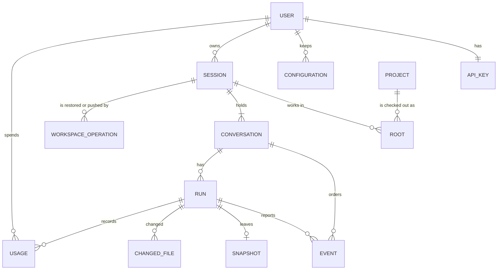

# Data model

What the API keeps, how the parts relate, and what the model leaves room for. This is the
conceptual model: the entities and their relations, not tables. The tables, their columns,
indexes and migrations belong to harness-api, which is the only writer of its database. The
terms are in the [glossary](../glossary.md). None of it is built yet.

The maintainer set its shape on 2026-11-19. Much of it follows from the flows and the other
design documents, which this document links rather than repeats.

The CLI used locally keeps its own store, without the API, and it is not designed here; see
[harness-cli#21](https://github.com/Mikode13/harness-cli/issues/21). The harness stores
nothing: it gives its consumers events and a snapshot, and each stores what it needs.

## The entities

Every entity has an id of its own.

| Entity              | What it is                                                                                                                           | Where it is decided                                                            |
| ------------------- | ------------------------------------------------------------------------------------------------------------------------------------ | ------------------------------------------------------------------------------ |
| User                | A person who may use the product. An id and an optional name.                                                                        | [Users and keys](#users-and-keys)                                              |
| API key             | The key a user's requests carry. One per user, kept as a hash, and it can be disabled.                                               | [security](security.md#an-api-key-for-each-user)                               |
| Configuration       | A user's agents and workflows, so that they are set without code.                                                                    | Its content is not designed.                                                   |
| Project             | A repository registered on the server.                                                                                               | [create-session](../flows/create-session.md#which-projects-a-session-works-in) |
| Session             | What a user lists, opens, renames and deletes. Its title, its projects, and whether deleted.                                         | [create-session](../flows/create-session.md)                                   |
| Root                | A project checked out for a session: its worktree, the branch's provisional name, the name it was published under, and its upstream. | [changes-and-push](../flows/changes-and-push.md#the-name-of-the-branch)        |
| Conversation        | The active one of a session, or an archived one.                                                                                     | [clear-and-delete](../flows/clear-and-delete.md)                               |
| Event               | What a client shows of a conversation, numbered in one order, with the version of its schema.                                        | [events](events.md)                                                            |
| Run                 | What one prompt started: the prompt's id, its state, and the agent or workflow and the model it used.                                | [run lifecycle](run-lifecycle.md)                                              |
| Snapshot            | What the next run's agent continues from, kept as the harness gives it.                                                              | [prompt-and-reconnect](../flows/prompt-and-reconnect.md)                       |
| Changed file        | A file a run changed, so that a client shows a run's changes.                                                                        | [changes-and-push](../flows/changes-and-push.md)                               |
| Workspace operation | A restore or a push, with each of its steps, so that a restart finds one cut short.                                                  | [restart](../flows/restart.md)                                                 |
| Usage               | What a run spent and where its time went, for each user.                                                                             | [Traceability](#traceability)                                                  |

## How the parts relate

- **Events belong to the conversation, not to the run.** Everything a client shows of a
  conversation takes its number from one count; some events are of no run, such as what the
  user sent or a change of state. An event that a run reported also names its run.
- **A conversation has many runs, one for each prompt.** The agent, or the workflow, and the
  model are chosen for each run, not for the conversation, so one conversation can mix agents
  of different providers. That is what the harness is for.
- **What a run changed belongs to the run.** A workflow is configuration: which agents and
  which stages. A run carries it out, and the files changed are the run's.
- **A run leaves at most one snapshot.** The next run starts from the last one stored; see the
  [run lifecycle](run-lifecycle.md#what-is-left-after-a-run-that-does-not-complete).

## Users and keys

- **A few people the maintainer knows each have a user and a key.** There is no sign-up and no
  password. The maintainer creates a user and its key, and disables a key that is misused.
  Someone who wants to give access to another person needs another key for them.
- **A key is kept as a hash**, never as it was given.
- **A session has one owner.** Chats with several people are wanted later, for a few cases.
  So that the model does not close that door, what a user sends is an event that names its
  author, and nothing assumes that the owner of a session is the only one who writes in it.

## Traceability

The API records what each user does and what it costs, for two reasons: to see whether a key
is misused, and to find where the time goes, such as in tools, in the model's thinking or in
latency. Usage is recorded for each run and can be read for each user.

What it records, how it is collected and how it is read are not designed.

## Open points

Not decided.

- **The database engine.** SQLite fits an API that is the only writer, on one server; a server
  database such as PostgreSQL fits searching archived conversations (R13 of
  [mvp.md](../mvp.md)) and was assumed by the older issues of harness-api.
- **The format of the ids.** The client already generates the ids of a session and of a
  prompt; see [create-session](../flows/create-session.md).
- **Who creates a key, and how.** The maintainer, through the API, was described; the command
  is not designed.
- **Which projects each user may work in.** The git credential is the maintainer's own
  account, so a push by another user is made as the maintainer; see
  [security](security.md#git-credentials).
- **Other users and the accepted risk.** The agent users of the operating system are shared by
  every user, so the accepted risk on the git credential now reaches the sessions of other
  people; see [security](security.md#an-accepted-risk-for-now).
- **Memories and plans.** They belong to a user, and to a group once there are groups. They are
  R12 of [mvp.md](../mvp.md), and are designed with their flows.
- **Members of a session.** How several people take part in one conversation, and whose
  memories it uses.
- **What usage records, and how.**
- **Where the changes a client sees are read from**: the changed files of a run, or git. It
  is an open point of [changes-and-push](../flows/changes-and-push.md#open-points).
