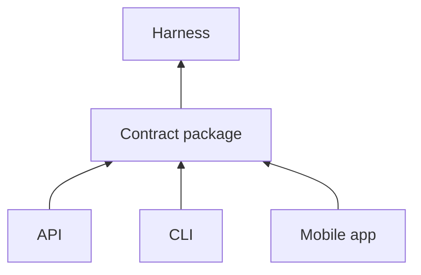

# Events

What an event is in the product, who defines each kind, and how a client receives them. The
maintainer closed this on 2026-11-15. The terms are in the [glossary](../glossary.md). None
of it is built yet.

## Two families

There are two kinds of event, and they are kept apart.

- **What happens inside a run.** A tool's activity, text, an ask, the final answer, an
  error. These are the harness's: the harness defines them.
- **The state around a run.** That the workspace is being set up, that a run was interrupted
  by a restart, that a session was cleared. These are the product's. The harness cannot
  define them: a harness that defined "interrupted because the API restarted" would know
  the API under another name.

## Who defines each, and who depends on whom

An arrow reads "depends on".

- **The harness** defines the first family. It knows nothing of the API, the CLI or any
  other consumer, and every dependency points towards it.
- **A contract package** defines the second family. It holds types only, and depends on the
  harness for the first family.
- **The API, the CLI and the mobile app** depend on the contract package. A client has one
  place to look for every event it can receive, and no client depends on the API's code.

## The harness's events are reused

The API stores and delivers the harness's events as the harness defines them. It does not
translate them into a schema of its own, so there is one schema and nothing to map.

The API adds only what it needs. These are the events it adds:

| Event            | Family  | Why the API adds it                                                      |
| ---------------- | ------- | ------------------------------------------------------------------------ |
| User message     | Product | A second device has to see what the first one sent.                      |
| Final answer     | Harness | Today it travels in the result of the run, not as an event.              |
| Ask              | Harness | Today it is a callback of the run, not an event.                         |
| Answer to an ask | Product | It comes from a client, through the API.                                 |
| Run state change | Product | The states are the product's; see the [run lifecycle](run-lifecycle.md). |
| Error            | Harness | Today the run ends by throwing it, not with an event.                    |

The final answer and the ask happen inside a run, so they belong to the first family, and
the harness should offer them as events itself. Until it does, the API builds them from the
run's result and from its callback. [harness-needs.md](harness-needs.md) lists this.

## Each stored event carries the version of its schema

A stored event outlives the version of the harness that produced it. Each one is stored with
the version of its schema, so an old event can still be read after the harness changes a
type.

## Two subscriptions

A client receives events through subscriptions; see the flows
[prompt-and-reconnect](../flows/prompt-and-reconnect.md) and
[ask-and-answer](../flows/ask-and-answer.md).

- **The conversation's subscription** carries what happens in one conversation. A client
  holds it while it has that conversation open. The events of the first family go only here.
- **The user's subscription** carries only changes of state, for every session of the user.
  A client holds it to show, on the list of sessions, that a session is working or waits for
  an answer. It is part of the contract between the API and the clients; the harness does
  not know it exists.

## One order

Everything a client shows of a conversation, what the user sent and every event, shares one
order: each takes its number from the same count of that conversation. A client shows them
in that order, and reconnects by saying the last number it saw.

## Open points

Not decided.

- **The contract package's name**, and the repository it lives in.
- **The exact types** of the events the API adds, and of the changes of state.
- **Whether the conversation's subscription also carries the state of its own runs.** A
  client inside a conversation needs to know that its run is `waiting_for_input` or was
  `interrupted`. Whether it reads that from the conversation's subscription or from the
  user's was not discussed.
- **Whether the harness offers the error as an event too.** Only the final answer and the
  ask were named as needs.
- **The transport.** See the open points of
  [prompt-and-reconnect](../flows/prompt-and-reconnect.md#open-points).
