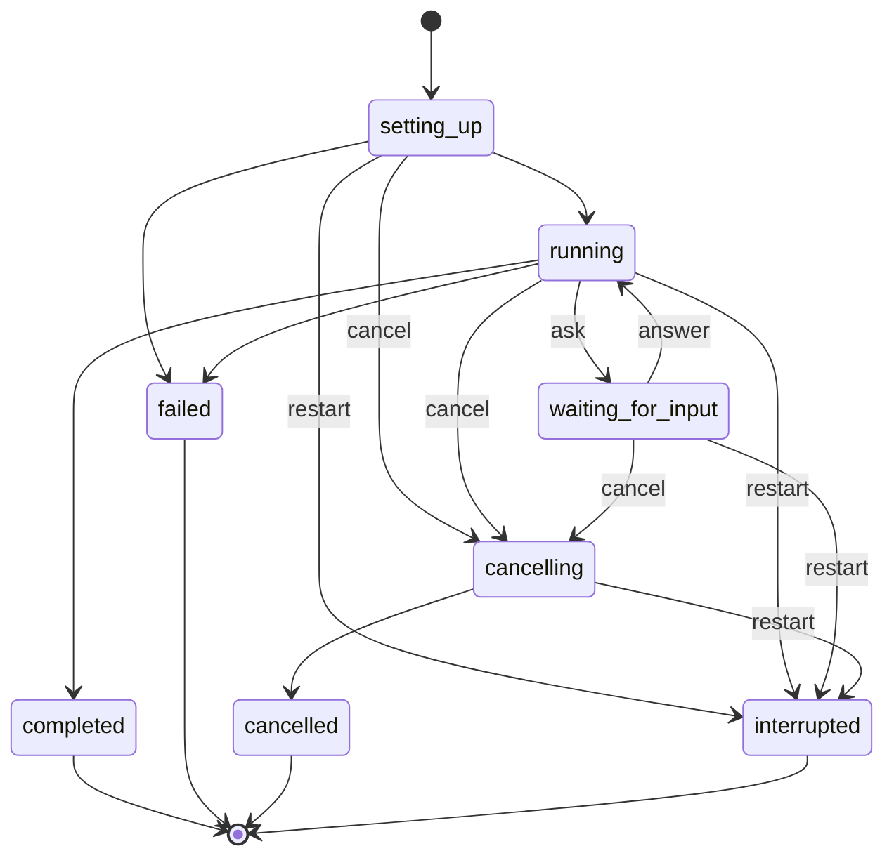

# Run lifecycle

How a run starts, where it executes, which states it goes through and what is left when it
ends. The maintainer decided this on 2026-11-14, in the system-design discussion of agenda
items 1 and 2 of [mvp.md](../mvp.md). The terms are in the [glossary](../glossary.md). None of it
is built yet.

## Where a run executes

The API starts one executor for each run, in the session's sandbox: a container of its own
for each session; see [security](security.md#a-sandbox-for-each-session). The executor runs
the harness for that run and nothing else.

- The executor talks only to the API, over a local channel. It does not connect to the
  database.
- Before the executor, the API starts workspace processes and a transfer process, one after
  another, when the session's workspace has to be prepared. The workspace processes run in the
  sandbox too and the transfer process outside it; they talk only to the API, and all end before
  the executor starts. See the [rules](#rules).
- The API is the only writer of the database, and so the only writer of a run's state. The
  executor reports what happens; the API stores it and decides the state.
- While the API runs, it knows an executor ended because its process exited. No heartbeat
  is needed for that.
- An executor does not end with the API. It can outlive the API that started it, and a
  command can outlive the executor that started it; a sandbox keeps running when the API
  stops. The first
  of the [rules](#rules) says what that requires.

## States

| State               | Meaning                                                                 |
| ------------------- | ----------------------------------------------------------------------- |
| `setting_up`        | The prompt is accepted and stored, and the workspace is being prepared. |
| `running`           | The harness is working.                                                 |
| `waiting_for_input` | The run asked the user something and waits. Its last event is an ask.   |
| `cancelling`        | The user cancelled, and the executor is stopping what it started.       |
| `cancelled`         | The executor confirmed that everything stopped.                         |
| `completed`         | The run ended with its answer, and its snapshot is stored.              |
| `failed`            | The run ended with an error.                                            |
| `interrupted`       | The API restarted, or the executor died, while the run was not ended.   |

`cancelled`, `completed`, `failed` and `interrupted` are final: a run in one of them never
changes again.

In the diagram, "restart" stands for a restart of the API and for the death of an executor.

## Rules

- **A workspace process prepares the workspace, while the run is `setting_up`.** The API starts
  it before the run's executor, in the session's sandbox with the worktrees writable, whatever
  the run's agent. Every run checks that its session's workspace is ready and has it prepared
  when it is not, so the first run clones and a later one rebuilds what was lost. A failure
  while preparing ends the run as `failed`. See [create-session](../flows/create-session.md).
- **Everything a run started is gone before another run starts.** Ending a run means ending
  its executor, the workspace or transfer process that was preparing, and every
  process they started, and confirming that none is left.
  Until that is confirmed the run is not ended, and neither its conversation nor its
  workspace takes another run. It holds for a cancellation, for an executor that died and
  for a restart of the API: a process that lost its parent keeps running, and marking its
  run `interrupted` while it runs would let two runs write in the same workspace. How the
  processes are ended and how their end is confirmed is an [open point](#open-points).
- **One active run per conversation.** A prompt sent while a run of the conversation is not
  ended is rejected as busy, as R05 requires. Nothing is queued. A prompt whose id the API
  already has is not a new prompt: it gets the acceptance and the run of the first time,
  whatever state that run is in.
- **A restore or a push holds the workspace as a run does.** A workspace process that
  restores code or pushes, and the transfer process of a push, work outside a run. While
  they work, their session takes no prompt, which is rejected as busy, and neither a clear
  nor a deletion. They are ended and confirmed gone as a run's processes are. After a
  restart, the API has to recognize a restore or a push that was in progress, end or
  reconcile it, and confirm that the workspace can be used again, before the workspace
  takes any work. See [restart](../flows/restart.md).
- **One writing run per workspace.** Whether a run writes is known before it starts: its
  agent has tools that write, or it has none. Two runs that write in the same workspace
  would work against each other. Inside one run, several subagents may work in the
  workspace at once. On the server each session has worktrees of its own, so this follows
  from the rule above.
- **A new prompt waits for `cancelled`.** While a run is `cancelling`, what it started may
  still be writing, so the conversation stays busy until the executor confirms the stop.
- **No clear and no delete while a run is active.** The API rejects clearing or deleting a
  session whose conversation has a run that is not ended. The clients show a message or do
  not offer the action, and the API enforces it whatever the client does.
- **Cancelling rejects a pending ask.** A run cancelled while it is `waiting_for_input` has
  its ask rejected.
- **A late answer does not count.** An answer that arrives after the run was cancelled, or
  after the ask was answered, is not considered and does not resume anything.
- **A restart closes a pending ask.** The ask is a stored event, so a client that reconnects
  gets it again as the last event and can answer it. After a restart, the API has lost its
  channel to the executor that asked, whether or not that process is still there, so an
  answer cannot reach it. Once everything the run started is confirmed gone, the run becomes
  `interrupted` and its ask is closed, so no client shows a question that leads nowhere.
- **A run is `completed` once its snapshot is stored.** The executor hands the snapshot over
  with the final answer, and the API stores both before it ends the run. A conversation
  whose messages are stored and whose snapshot is lost shows the chat, and has lost what the
  next prompt needs. See [prompt-and-reconnect](../flows/prompt-and-reconnect.md).
- **A run whose snapshot cannot be stored ends as `failed`.** The event with its answer is
  kept, so the user still reads it.

## What is left after a run that does not complete

After `failed`, `cancelled` or `interrupted`, the user sees everything up to the last event,
and at most one more message that says what went wrong. Nothing is removed.

The code the run changed stays in the workspace. Nothing is undone by itself: the harness's
history lists the run with what it changed, and the user decides whether to restore it; see
[changes-and-push](../flows/changes-and-push.md).

The next run starts from the last snapshot that was stored, the one a completed run left,
and its model is told that the earlier run did not complete. It can recover the
conversation, and compacts it when it is very large.

## Alternatives considered

- **Running the harness inside the API's process.** The simplest: one process, and the
  harness's callbacks are plain calls. Rejected because a run that hangs or runs out of
  memory takes the API down with it, and because the commands a model starts would run as
  the user that holds the database credentials.
- **An executor as a service of its own.** It would also let the API restart without ending
  the runs. It needs a channel that survives either side going away, a heartbeat to tell a
  dead executor, and a way to reconcile both states when they meet again. Left for later:
  the states above do not change if the executor moves out.

## Open points

Not decided. Each is an input to the next design steps.

- **How a run's processes are ended and confirmed gone.** It has to reach a process that
  lost its parent, and work after a restart of the API. The sandbox gives a way: stopping
  what runs in it, which the container engine confirms. Whether a sandbox is stopped, or only
  the processes of the run in it, depends on whether it lives for a session or for a run.
- **How a restore or a push cut short by a restart is ended and reconciled.** The API
  recognizes it from the steps it stores; see [restart](../flows/restart.md). What it then
  does with each step is not decided.
- **The channel between the API and the executor.** What carries the events one way and the
  answers and the cancellation the other.
- **Reasons within `failed`.** Whether a failed run names a kind of failure, such as the
  provider or the workspace, or only carries a message.

## Words used elsewhere

- **[#4](https://github.com/Mikode13/harness-api/issues/4)** names the same states for a
  task, with `queued` where this document says `setting_up`, and without `cancelling`.
- **[#6](https://github.com/Mikode13/harness-api/issues/6)** describes "a separately
  runnable backend executor" that claims queued tasks from PostgreSQL. Here the API starts
  an executor per run in the session's sandbox, and the executor does not reach the database. The issue
  keeps its text until it is refined. Its other rules stand: a cancellation waits for the
  commands to end before it reports `cancelled`, a dead executor's work becomes
  `interrupted`, and a started prompt is never replayed by itself.
