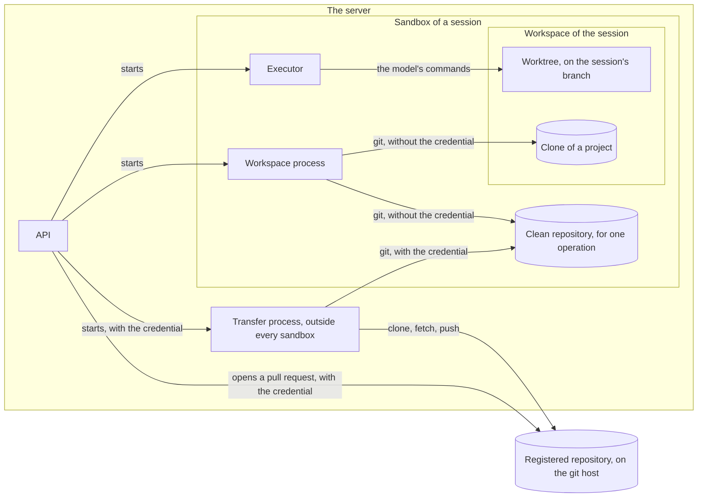
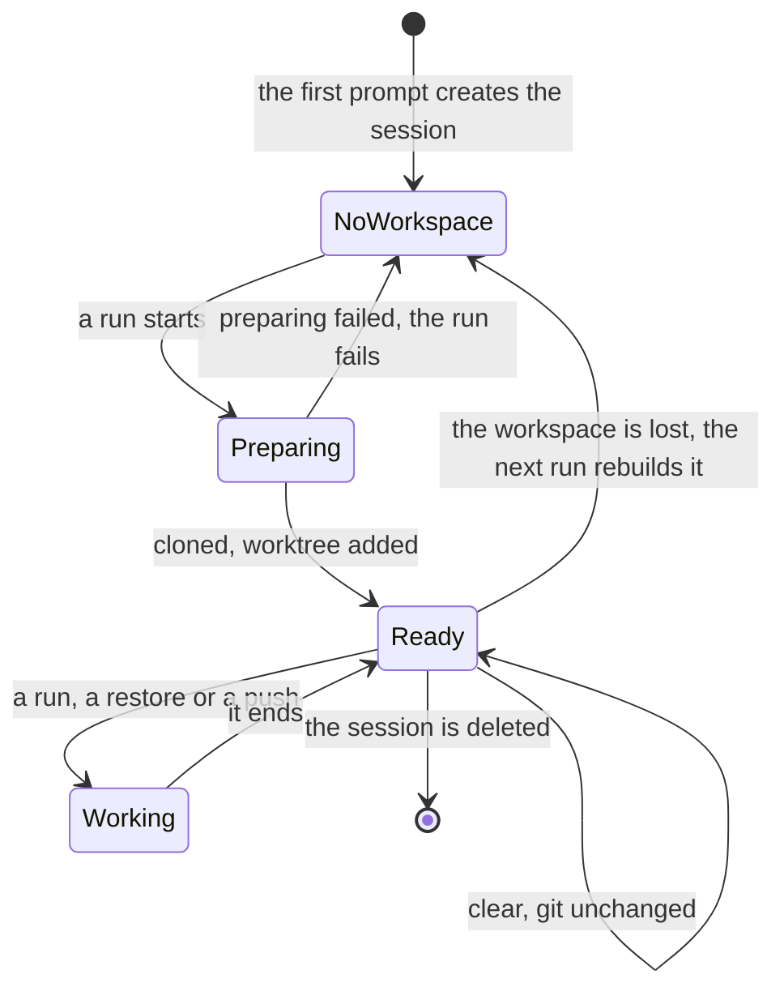
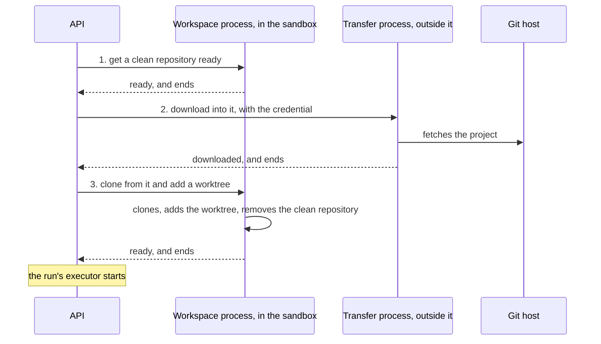
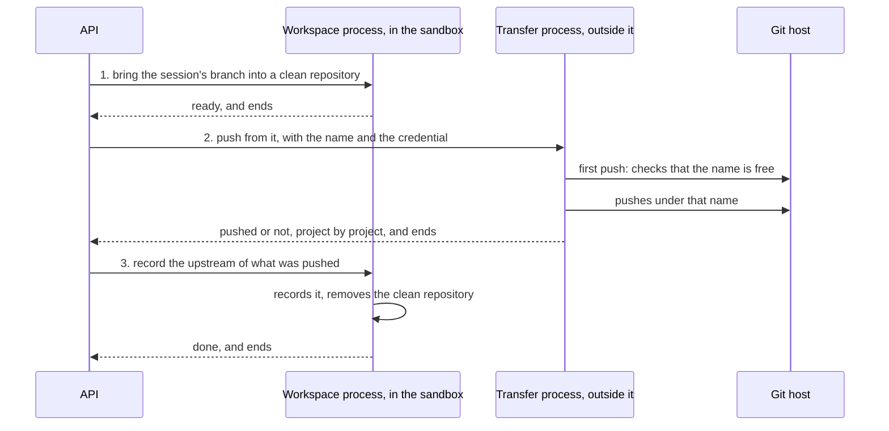

# The workspace and git

How a session's workspace lives from its first run to its deletion, which processes touch it,
and how the git credential is kept away from what a model runs. This document puts together
what the flows and the other design documents decide; each rule is stated where the link
points, and this document adds none. None of it is built yet. The terms are in the
[glossary](../glossary.md).

## The pieces

- **A sandbox** is the container a session's executor and workspace processes run in. It sees
  only its session's workspace and, during the workspace steps of a transfer, its clean
  repository. See [security](security.md#a-sandbox-for-each-session).
- **A worktree** is a copy of a project's repository, on a branch of its own. A workspace has
  one per project, its [roots](../glossary.md#root).
- **A clean repository** is made for one clone, fetch or push, and removed when it ends. No
  command of a model has written in it, and it is the only place git uses the credential.
- **The registered repository** is the project's repository on the git host. The credential
  reaches only the registered ones.

## Who does what

| Process           | Started by | Runs as                  | Holds the credential | Runs git in                          |
| ----------------- | ---------- | ------------------------ | -------------------- | ------------------------------------ |
| Executor          | The API    | In the session's sandbox | Never                | The worktree, through the model      |
| Workspace process | The API    | In the session's sandbox | Never                | The worktree, and a clean repository |
| Transfer process  | The API    | Outside every sandbox    | Yes, for one step    | A clean repository only              |

- **An executor** runs the harness for a run. Its agent works in the worktree, and the
  commands the model starts run there.
- **A workspace process** prepares the workspace inside a run, before the executor, and outside
  any run restores code and does the local parts of a push.
- **A transfer process** does one clone, fetch or push with the credential, in a clean
  repository, with nothing of the sandbox's home: no user or system git configuration, an
  empty home, a fixed `PATH` and the system's git. See
  [security](security.md#git-credentials).
- **No two of them work on a session at once.** A restore or a push is rejected while a run of
  the session is not ended, and a prompt while a restore or a push works. See the
  [run lifecycle](run-lifecycle.md#rules).

## The life of a workspace

- **It is prepared late.** Nothing is cloned until a run needs it, and every run checks; see
  [create-session](../flows/create-session.md#preparing-the-workspace).
- **It is fixed when the session is created**: the projects the user chose, each on a branch
  of its own whose provisional name carries the ids of the session and of its user.
- **A clear changes nothing in git.** The conversation is archived; the worktrees stay on their
  branch. See [clear-and-delete](../flows/clear-and-delete.md#clear).
- **What a deletion does to the workspace** is not decided; see
  [clear-and-delete](../flows/clear-and-delete.md#open-points).

## A transfer, in three steps

Every clone, fetch and push is three processes the API starts one after another, each ending
before the next starts. They hand over only the clean repository's path, which the API names,
and the API stores each step before it starts it. Before the transfer step, everything the
first step started in the sandbox is ended and confirmed gone, and the clean repository is
mounted into the sandbox only for the workspace steps.

### Preparing a workspace

### Pushing

- **The user asks for it**, from a client; nothing pushes on its own. See
  [changes-and-push](../flows/changes-and-push.md#pushing-and-opening-a-pull-request).
- **The name is chosen at the first push** and kept by the API. The worktree's branch keeps its
  provisional name, since the harness's history ties a run's commits to it. Later pushes go to
  the same name. See [the name of the branch](../flows/changes-and-push.md#the-name-of-the-branch).
- **The upstream is recorded in the worktree** so that the harness refuses to reset commits that
  were pushed.

## Why it is built this way

A command a model starts runs in its session's sandbox and can leave things for git to run later: a
hook, a changed configuration, a file in the user's home. Each rule closes one way that was
found, most of them reproduced:

| What a command could leave                                 | What keeps it from the credential                               |
| ---------------------------------------------------------- | --------------------------------------------------------------- |
| A hook in the worktree's repository                        | Git uses the credential only in a clean repository              |
| A `pushurl` or an `insteadOf` in the worktree's repository | Turning hooks off was not enough; the clean repository is       |
| A hook run by a restore or by adding a worktree            | The workspace process never holds the credential                |
| A hook or an `insteadOf` in the user's `~/.gitconfig`      | Git on a clean repository reads no user or system configuration |
| An `init.templateDir` copied into a new repository         | The clean repository is made in that same environment           |
| A clean repository kept and written in                     | A new one for each operation, removed after it, never reused    |

The evidence is in [learnings](../docs/learnings.md). Code of another session, which could
read the credential from a transfer process while both ran as the same user, was an accepted
risk until the sandbox of each session closed it; see
[security](security.md#the-accepted-risk-closed-by-the-sandbox).

## Open points

Each is listed, and stays open, in the document the link points to.

- How a project is registered, and whether sessions on one project share a clone:
  [create-session](../flows/create-session.md#open-points).
- What a rebuilt workspace starts from: [create-session](../flows/create-session.md#open-points).
- A name taken in only some projects, a bound on a push that hangs, and how the model writes a
  pull request's text: [changes-and-push](../flows/changes-and-push.md#open-points).
- What reconciling a restore or a push cut short takes: [restart](../flows/restart.md#open-points).
- What a deletion does to the workspace:
  [clear-and-delete](../flows/clear-and-delete.md#open-points).
- What a sandbox mounts, its network and its image: [security](security.md#open-points).
