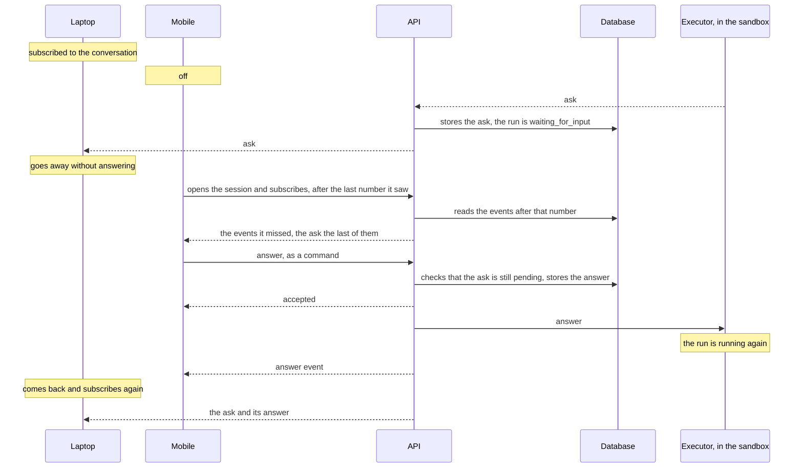

# Ask and answer from another device

R06 of [mvp.md](../mvp.md): a run asks the user something, a question or an approval, and
the user answers from any device, not only from the one that started the run. The maintainer
closed this flow on 2026-11-15. The terms are in the [glossary](../glossary.md). None of it
is built yet.

## The flow

1. **The executor reports the ask.** The API stores it as an event, and the run becomes
   `waiting_for_input`.
2. **Whoever is subscribed to the conversation gets it.**
3. **A device answers.** The API checks that the ask is still pending, stores the answer and
   passes it to the executor.
4. **The run is `running` again**, and every subscribed device sees the answer as an event.

## Rules

- **An ask is not sent to a device.** The API adds it to the conversation's events, and the
  devices that have the subscription to that conversation open get it. Nothing is routed.
- **A device is active when its subscription is open.** A device that is off has no
  connection, so it gets nothing, and the API needs to know nothing about it. There is no
  list of devices to keep.
- **The device that sent the prompt is not special.** A question does not depend on the
  terminal that started the run, as R06 says.
- **A device that was away asks for the events again.** When it comes back it gets the
  events after the last number it saw: the ask, which it can answer if it is still pending,
  or the ask and its answer if another device answered meanwhile. The API never needs to
  know whether a device received the ask.
- **The first answer wins.** A second answer to the same ask is rejected and resumes
  nothing. Both devices see the one answer event.
- **The device that answers updates its screen from the event.** Its command gets back only
  accepted or rejected. It marks the ask as answered when the answer event arrives through
  the subscription, as every other device does, so there is one way to update a screen.
- **A rejected approval does what the harness does.** The model is told that the user said
  no, and the run goes on: the model takes another way or asks. The product adds nothing.
- **Cancelling rejects a pending ask, and a restart closes it.** A run cancelled while it
  waits has its ask rejected, and an answer that arrives later does not count. After a
  restart the API has lost its channel to the executor that asked, so once everything the
  run started is confirmed gone the run becomes `interrupted` and its ask is closed. See the
  [run lifecycle](../design/run-lifecycle.md#rules).

## A session that waits, seen from the list of sessions

A device may have the product open on the list of sessions, without being inside the
conversation that asks. To show there that a session waits for an answer, it holds a second
subscription, for the user as a whole, that carries only changes of state.

This subscription is part of the contract between the API and the clients. It is there to
keep the user informed and has nothing to do with the model, so the harness does not know
that it exists. See [events](../design/events.md).

## Notifications

Out for now. The maintainer wants very few, and what they are for is one case: knowing that
something waits for him while he is away from the computer, cooking or exercising, and
answering from the mobile.

## Open points

- **Which notifications, when they come.** One was proposed as enough for that case: that an
  ask is pending. R07 of [mvp.md](../mvp.md) asks for more, a notification on completion and
  on an error that stops the run as well, so the two have to be reconciled.
- **How a mobile receives one.** A notification is for a device that is not connected, such
  as a mobile in the background, and that is the one place where the API needs to know a
  device. A mobile registering a push token for it was proposed.
