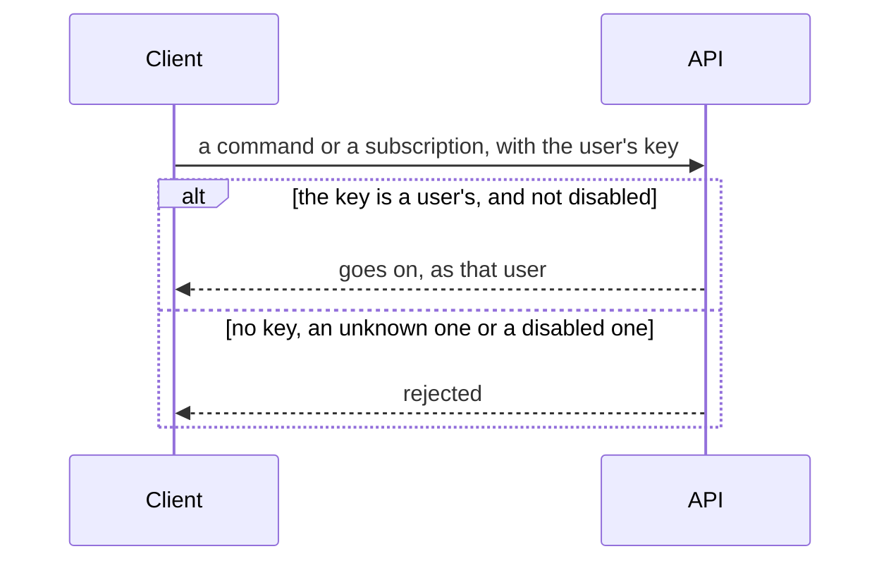

# Authenticate a device

How the API knows which user a request comes from. The maintainer decided it on 2026-11-15
and gave each user a key on 2026-11-19, in
[security](../design/security.md#an-api-key-for-each-user); this document puts it in order. The terms
are in the [glossary](../glossary.md). None of it is built yet.

## The flow

1. **Every request carries the key**: each command, and each subscription to events.
2. **The API accepts only the keys of its users.** It compares the key with the hashes it
   keeps, and rejects a key that is unknown or disabled. It exists so that nobody else can
   use the product's infrastructure through the server.
3. **The request is that user's.** What it reads and changes is the user's, and what it
   costs is recorded for that user.
4. **Every id a request names must be the user's.** A session, a conversation, a prompt, a
   run or an ask must belong to a session the user owns; once a session can have members, to
   one the user is a member of. Anything else is rejected. This holds for every flow:
   sending a prompt, answering an ask, clearing, deleting, restoring, pushing and
   subscribing.
5. **The ids a client generates are unique for each user.** The client generates the ids of a
   session and of a prompt, so two users could send the same one. Each user's ids are apart
   from every other user's: the same id from two users names two things, never a conflict,
   and a request cannot learn whether an id exists for another user.
6. **A user's devices share that user's key.** There is no key per device.

Requests travel over HTTPS, so the key is encrypted on the way; see
[security](../design/security.md#how-the-server-is-reached).

## What follows from one key per user

- **The API cannot tell one device from another, and does not need to.** An ask is not sent
  to a device, and a device gets events because its subscription is open; see
  [ask-and-answer](ask-and-answer.md).
- **A device is not registered.** Nothing lists the devices of the user.
- **Losing a device means changing that user's key**, on every device of the user. A key per
  device, to revoke one alone, was proposed and declined: it is not a concern for the
  maintainer.

## Open points

Not decided.

- **How the key reaches a device, and where the client keeps it.**
- **How a key is created, changed and disabled**: through the API, by the maintainer, was
  described; the commands are not designed.
- **How a mobile is known for notifications.** A notification is for a device that is not
  connected, the one place where a device has to be known; see
  [ask-and-answer](ask-and-answer.md#open-points).
