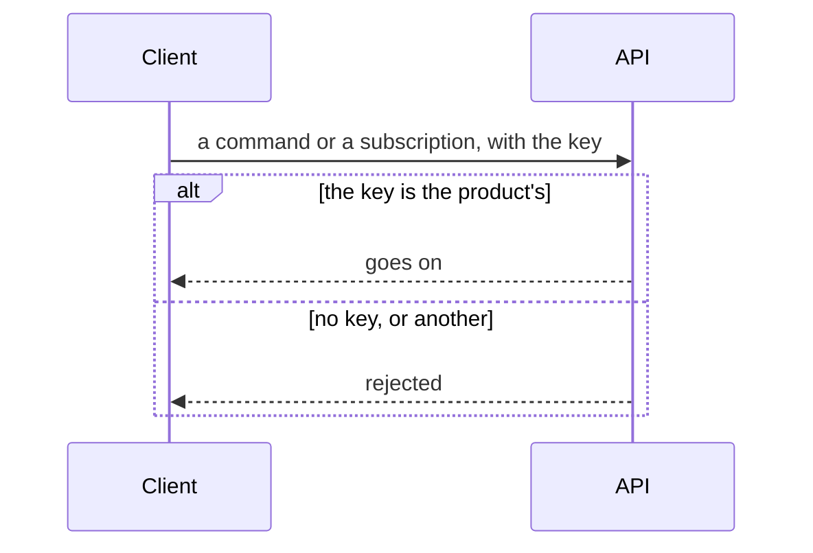

# Authenticate a device

How the API knows that a request comes from the user. The maintainer decided it on
2026-11-15, in [security](../design/security.md); this document puts it in order. The terms
are in the [glossary](../glossary.md). None of it is built yet.

## The flow

1. **Every request carries the key**: each command, and each subscription to events.
2. **The API accepts one key of the product's own, and only that key works.** It exists so
   that nobody else can use the harness through the server.
3. **The maintainer's devices share it.** There is one user, and no key per device.

The server is reached only from a private network in the first slice; see
[security](../design/security.md#a-private-network).

## What follows from one key

- **The API cannot tell one device from another, and does not need to.** An ask is not sent
  to a device, and a device gets events because its subscription is open; see
  [ask-and-answer](ask-and-answer.md).
- **A device is not registered.** Nothing lists the devices of the user.
- **Losing a device means changing the one key**, on every device. A key per device, to
  revoke one alone, was proposed and declined: it is not a concern for the maintainer.

## Open points

Not decided.

- **How the key reaches a device, and where the client keeps it.**
- **How the key is changed.**
- **How a mobile is known for notifications.** A notification is for a device that is not
  connected, the one place where a device has to be known; see
  [ask-and-answer](ask-and-answer.md#open-points).
