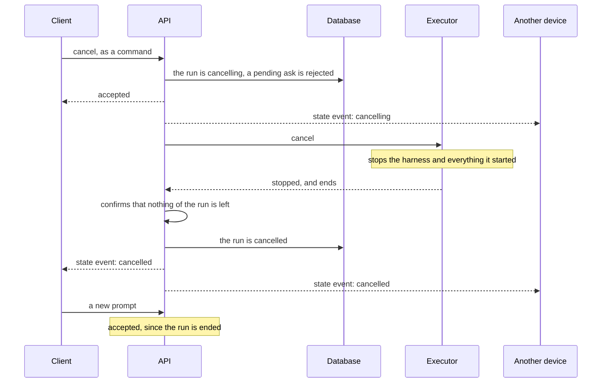

# Cancel

R05 of [mvp.md](../mvp.md): the user cancels a run that is working, and can then send a new
prompt. The rules were decided on 2026-11-14 and 2026-11-15, in the
[run lifecycle](../design/run-lifecycle.md); this document puts them in order. The terms are
in the [glossary](../glossary.md). None of it is built yet.

## The flow

1. **A client sends the cancellation as a command.** It gets back only that it was accepted.
   Disconnecting a client is never a cancellation.
2. **The run becomes `cancelling`.** If it was `waiting_for_input`, its ask is rejected, and
   an answer that arrives from now on does not count.
3. **The API tells the executor**, which stops the harness and everything the harness
   started, and says so. A run that is still `setting_up` has a workspace process instead,
   and perhaps a transfer process, which are stopped the same way.
4. **The API confirms that nothing of the run is left**: the executor and every process it
   started. Only then is the run `cancelled`.
5. **Every subscribed device sees both changes of state**, the one that cancelled as the
   others do.
6. **A new prompt is accepted once the run is `cancelled`.** While it is `cancelling`, a
   prompt is rejected as busy, because what the run started may still be writing in the
   workspace.

## A run that already ended

A cancellation that arrives when the run is already ended, such as one sent from a second
device a moment after the first, is answered with the state the run ended in. It is not an
error.

## What is left

The user sees everything up to the last event, and at most one more message. Nothing is
removed, and the code the run changed stays in the workspace until the user restores it.
The next run starts from the last snapshot that was stored, and its model is told that the
earlier run did not complete. See [what is left after a run that does not complete](../design/run-lifecycle.md#what-is-left-after-a-run-that-does-not-complete).

## Open points

Not decided.

- **An executor that does not confirm.** The rule holds either way: the run is not ended
  until everything it started is confirmed gone. How the API ends those processes itself,
  and confirms it, is an open point of the
  [run lifecycle](../design/run-lifecycle.md#open-points).
