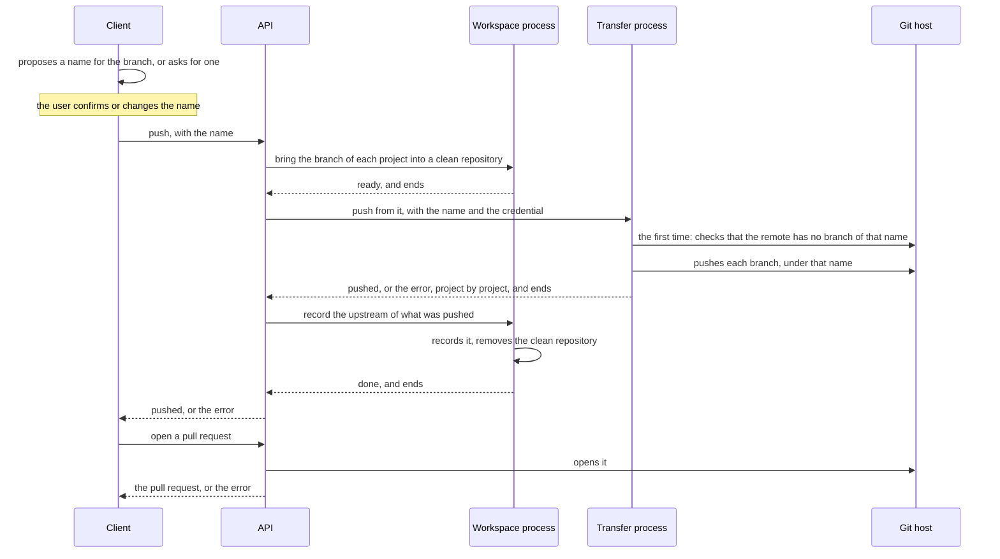

# See changes, restore code and push the branch

R09 of [mvp.md](../mvp.md), and how the work leaves the server: the user sees what a run
changed, restores the code to an earlier point, commits, pushes the session's branch and
opens a pull request. The maintainer closed this flow on 2026-11-16. The terms are in the
[glossary](../glossary.md). None of it is built yet.

Most of this is what the harness already does. The product adds two things: it lets the
user do it from any device, and it pushes and opens the pull request, which the harness
never does.

## What the harness already does

The product reuses these as they are, as R09 requires, and defines no second history of the
code.

- **Commit.** The harness commits only when the user answers that it should. By default it
  asks once, when the last phase of a run is approved. A committer agent writes the message.
- **See changes.** Its history lists the runs, with the files each one changed and who
  changed each, and gives a run's changes as a diff.
- **Restore.** Its history moves a workspace back and forward, one run at a time. A file
  that no longer holds what the history expects is left as it is, and the move is reported
  as partial. For the commits of a run it offers three things: keep them, revert them, or
  reset the branch to before them.
- **A pushed branch is not reset.** The harness refuses to reset a branch when its upstream
  already holds one of those commits. Keeping and reverting stay.
- **The agent is told.** After a move, the agent learns on its next run what was undone and
  what git did with the commits.

## What the product adds

### The commit is an ask

The harness's question about committing reaches the clients as any other ask, and is
answered from any device; see [ask-and-answer](ask-and-answer.md). The product uses the
harness's default, one question at the end of the run.

### Seeing changes and restoring are commands of the client

- **The user asks from a client.** For a restore, the API starts a workspace process, which
  calls the harness's history.
- **Only while no run of the session is active**, since one writer works in a workspace at a
  time; see the [run lifecycle](../design/run-lifecycle.md#rules). While a restore or a push
  works, the session takes no prompt, and neither a clear nor a deletion.
- **A restore changes the code, not the conversation.** The messages stay as they are, and
  the next run's agent is told that the code was restored.
- **The outcome is reported as the harness gives it**: complete, or partial with the files
  it left.

### Pushing and opening a pull request

- **A workspace process and a transfer process push**, as they prepare a workspace: both
  started by the API, as the writing user, and only the transfer process with the
  credential.
- **A push waits until no run of the session is active**, as a restore does. A run that is
  working may be committing, and one piece of work at a time uses a workspace; see the
  [run lifecycle](../design/run-lifecycle.md#rules).
- **A push is reported project by project.** When it succeeds in one and fails in another,
  nothing is undone, and pushing again pushes what is missing.
- **A restore and a push cannot be cancelled.** The harness and git carry them out to their
  end, and the client offers no way to stop them.
- **The model writes the title and the description of a pull request.** Nobody confirms
  them first: the user sees the pull request and asks for a change if one is needed.
- **The API opens the pull request with the same credential** the transfer process pushes
  with; see [security](../design/security.md#git-credentials).
- **Neither is ever automatic.** The branch is pushed, and a pull request is opened, only
  when the user asks for it from a client. Nothing does it at the end of a run or after a
  commit.
- **A push trusts nothing a command could have left in the worktree.** It runs no hook,
  obeys no configuration a command could have changed, and goes to the repository
  registered for the project, not to what the worktree's configuration says.
- **So a push runs from a clean repository, not from the worktree.** The workspace process
  makes a repository of its own and brings the session's branch into it from the worktree's
  repository as a local path. A transfer process pushes from there with the credential, and
  does nothing else. No process that holds the credential runs git in the worktree's
  repository. The clean repository is made for that push and removed after it, so it is one
  more local copy for each push. The three steps are three processes, one after another;
  see [security](../design/security.md#git-credentials).
- **After a push, a workspace process records the upstream in the worktree's
  repository**, without the credential, for each project that was pushed. The push did not
  run there, and the upstream is what the harness reads to refuse a reset of commits that
  were pushed.
- **They are commands of the client, not commands a model runs.** So they happen when the
  user asks, and no model decides to push. That a command a model starts could still reach
  the credential is a risk accepted for now; see
  [security](../design/security.md#git-credentials).

### The name of the branch

Each worktree of a session is on a branch of its own, which git requires when the worktree
is created.

- **In the worktree it has a provisional name** that carries the id of the session, so it
  cannot collide, and it keeps that name for as long as the worktree exists.
- **It is published under another name, chosen at the first push.** The client proposes
  one, the user confirms or changes it, and the branch is pushed under that name, which
  becomes its upstream. When a session is created nobody knows yet whether the work is a
  fix or a feature; at the first push it is known.
- **The branch is never renamed in the worktree.** The harness's history ties the commits of
  a run to the name of the branch they were made on, and takes them back only while that
  branch is checked out. Renaming it would leave those commits where they are when a run is
  undone; see [learnings](../docs/learnings.md). The upstream is what the harness reads to
  refuse a reset once the commits are pushed, so that keeps working.
- **The model can propose the name**, when the user asks it to.
- **A session with several projects uses the same name in each.**
- **At the first push, a name the remote already has is an error.** Branches are deleted
  once they are merged, so it is not expected. The transfer process never publishes a
  session's branch onto one that is already there: the push fails, and the API passes the
  error to the client, which shows it.
- **Every later push goes to the branch's upstream.** After the first push the session's
  branch is on the remote under its name, and that is where its later commits go, such as
  the corrections a review asks for. The name is asked for once.
- **The API keeps that name and gives it to the transfer process with each push.** It is
  not read from the worktree's configuration, which a command could have changed to send
  the commits to another branch.

## Open points

Not decided.

- **A name for a point the code is restored to.** R09 calls it a retained checkpoint; in the
  harness it is a run of its history. The product has no term for it yet.
- **Whether the code history belongs to the session**, and so survives a clear. It is an
  open point of the [glossary](../glossary.md#open-points).
- **A restore or a push that the API's restart cut short.** The rule is in the
  [run lifecycle](../design/run-lifecycle.md#rules) and the steps in
  [restart](restart.md): the API has to recognize it, end or reconcile it, and confirm that
  the workspace can be used again. How is not decided.
- **What the name is proposed from**, the session's title, the plan or the changes, and
  which model proposes it. The projects' own rules for branch names have to hold.
- **Whether the commit question can be asked at another moment**, per phase or with the
  plan, as the harness allows, and where that is chosen.
- **What happens to a session's worktree and branch once its pull request is merged.** It
  belongs with the flow for clearing and deleting; see [the list of flows](README.md).
- **Where the changes a client sees are read from.** It is decided with the database.
