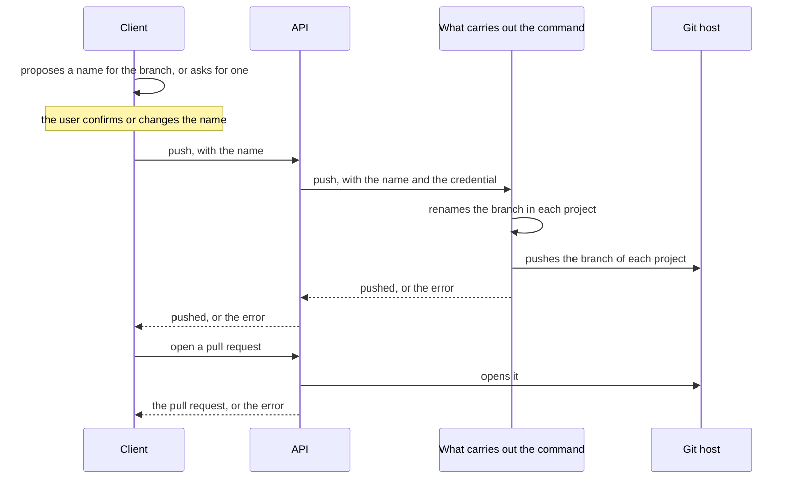

# See changes, restore code and push the branch

R09 of [mvp.md](../mvp.md), and how the work leaves the server: the user sees what a run
changed, restores the code to an earlier point, commits, pushes the session's branch and
opens a pull request. The maintainer closed this flow on 2026-11-16. The terms are in the
[glossary](../glossary.md). None of it is built yet.

Most of this is what the harness already does. The product adds two things: it lets the
user do it from any device, and it pushes and opens the pull request, which the harness
never does.

## What the harness already does

The product reuses these as they are, as R09 requires, and defines no second history of the
code.

- **Commit.** The harness commits only when the user answers that it should. By default it
  asks once, when the last phase of a run is approved. A committer agent writes the message.
- **See changes.** Its history lists the runs, with the files each one changed and who
  changed each, and gives a run's changes as a diff.
- **Restore.** Its history moves a workspace back and forward, one run at a time. A file
  that no longer holds what the history expects is left as it is, and the move is reported
  as partial. For the commits of a run it offers three things: keep them, revert them, or
  reset the branch to before them.
- **A pushed branch is not reset.** The harness refuses to reset a branch when its upstream
  already holds one of those commits. Keeping and reverting stay.
- **The agent is told.** After a move, the agent learns on its next run what was undone and
  what git did with the commits.

## What the product adds

### The commit is an ask

The harness's question about committing reaches the clients as any other ask, and is
answered from any device; see [ask-and-answer](ask-and-answer.md). The product uses the
harness's default, one question at the end of the run.

### Seeing changes and restoring are commands of the client

- **The user asks from a client**, and the API passes the command on to where the workspace
  is, which calls the harness's history.
- **Only while no run of the session is active**, since one writer works in a workspace at a
  time; see the [run lifecycle](../design/run-lifecycle.md#rules).
- **A restore changes the code, not the conversation.** The messages stay as they are, and
  the next run's agent is told that the code was restored.
- **The outcome is reported as the harness gives it**: complete, or partial with the files
  it left.

### Pushing and opening a pull request

- **Neither is ever automatic.** The branch is pushed, and a pull request is opened, only
  when the user asks for it from a client. Nothing does it at the end of a run or after a
  commit.
- **They are commands of the client, not commands a model runs.** So they happen when the
  user asks, and no model decides to push. That a command a model starts could still reach
  the credential is a risk accepted for now; see
  [security](../design/security.md#git-credentials).

### The name of the branch

Each worktree of a session is on a branch of its own, which git requires when the worktree
is created.

- **It starts with a provisional name** that carries the id of the session, so it cannot
  collide.
- **It gets its name at the first push.** The client proposes one, the user confirms or
  changes it, and the branch is renamed before it is pushed. When a session is created
  nobody knows yet whether the work is a fix or a feature; at the first push it is known.
- **The model can propose the name**, when the user asks it to.
- **A session with several projects uses the same name in each.**
- **A name that already exists is an error.** Branches are deleted once they are merged, so
  it is not expected. When it happens, the push fails, and the API passes the error to the
  client, which shows it.

## Open points

Not decided.

- **What carries out a command that is not a run**, such as a restore or a push. An executor
  exists for a run; see [where a run executes](../design/run-lifecycle.md#where-a-run-executes).
  The diagram above names it only by what it does.
- **Whether a push can happen while a run of the session is active.** A push renames the
  branch of each worktree the first time. Seeing changes and restoring wait for no active
  run; whether a push does too was not discussed.
- **A name for a point the code is restored to.** R09 calls it a retained checkpoint; in the
  harness it is a run of its history. The product has no term for it yet.
- **Whether the code history belongs to the session**, and so survives a clear. It is an
  open point of the [glossary](../glossary.md#open-points).
- **What the name is proposed from**, the session's title, the plan or the changes, and
  which model proposes it. The projects' own rules for branch names have to hold.
- **The title and the description of a pull request**: who writes them, and from what.
- **Whether the commit question can be asked at another moment**, per phase or with the
  plan, as the harness allows, and where that is chosen.
- **A push that succeeds in one project and fails in another.**
- **What happens to a session's worktree and branch once its pull request is merged.** It
  belongs with the flow for clearing and deleting; see [the list of flows](README.md).
- **Where the changes a client sees are read from.** It is decided with the database.
