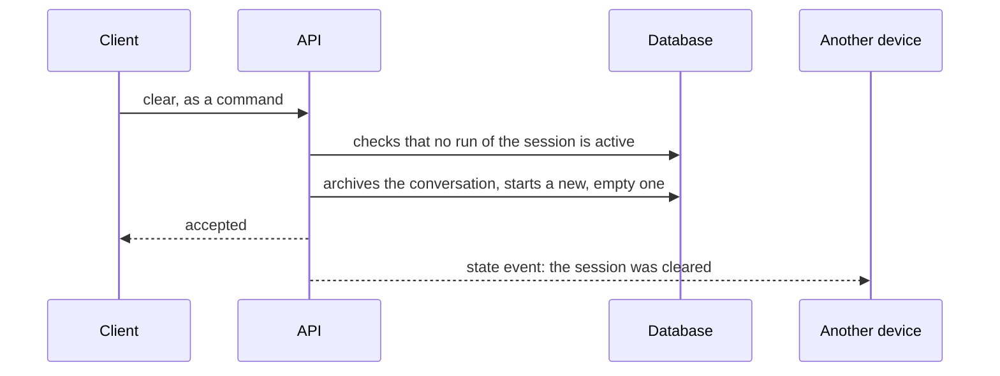
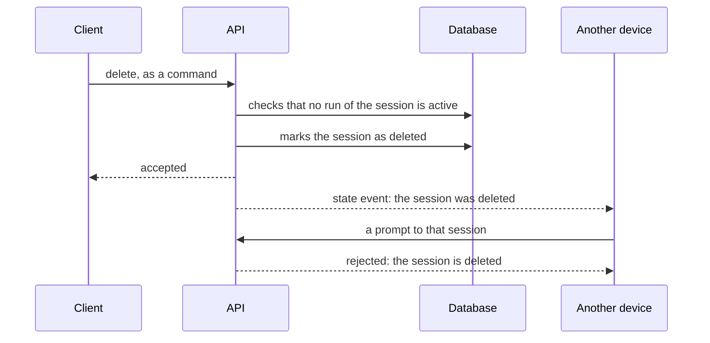

# Clear and delete

R01 of [mvp.md](../mvp.md): the user clears a session to start something else in it, or
deletes it. The terms and the rules were decided on 2026-11-13 and 2026-11-14, in the
[glossary](../glossary.md) and the [run lifecycle](../design/run-lifecycle.md); this
document puts them in order. None of it is built yet.

Clearing and deleting are different. A clear archives a conversation, which can still be
found. A deletion removes a session from everything the user sees.

## Clear

1. **A client sends the clear as a command.**
2. **The API rejects it while a run of the session is not ended.** The clients show a
   message or do not offer the action, and the API enforces it whatever the client does.
3. **The API archives the active conversation and starts a new, empty one** in the same
   session.
4. **The session, its title and its workspace stay.** The code is as it was.
5. **The other devices learn it as a change of state.**

The archived conversation still exists and can still be found, which is what R13 of
[mvp.md](../mvp.md) retrieves from. The new conversation has no run before it, so its first
run starts from no snapshot.

## Delete

1. **A client sends the deletion as a command.**
2. **The API rejects it while a run of the session is not ended**, as it does a clear.
3. **The session is marked as deleted.** Deletion is logical first; a real purge may come
   later.
4. **A deleted session is no longer returned** by listing, opening or retrieval.
5. **A device that still shows it cannot use it.** A prompt to a deleted session is
   rejected; the API neither brings the session back nor creates another. See
   [create-session](create-session.md).

## Open points

Not decided.

- **What a deletion does to the session's archived conversations.** The decision "Sessions
  hold conversations, and clearing archives" of [decisions](../docs/decisions.md) leaves it
  open.
- **What a deletion does to the workspace**: the worktrees, their branches, and work that
  was committed and not pushed.
- **Deleting one archived conversation** without deleting its session.
- **When a deletion becomes a real purge**, and what it removes then.
- **Whether the code history survives a clear.** It is an open point of the
  [glossary](../glossary.md#open-points).
- **A worktree and a branch after their pull request is merged.** Raised in
  [changes-and-push](changes-and-push.md#open-points).
