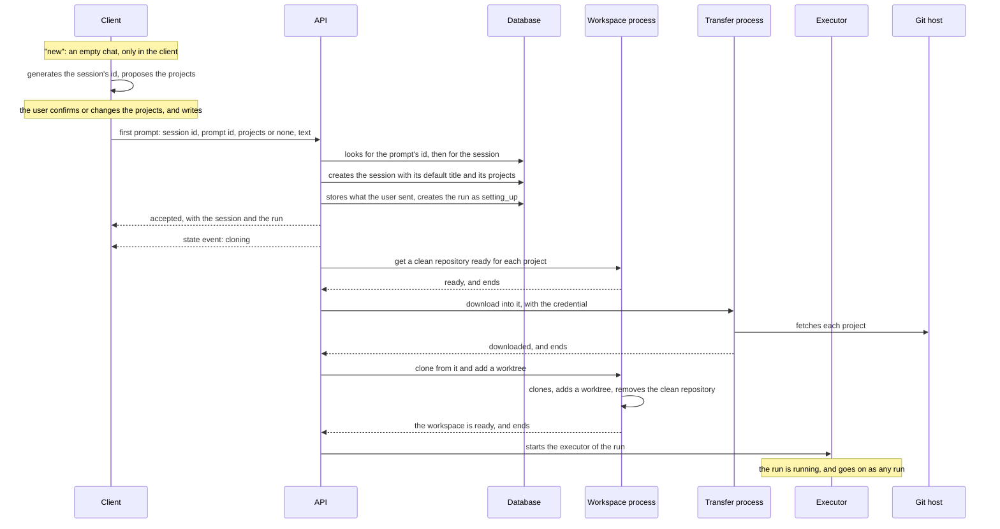

# Create a session and set up its workspace

How a session comes to exist, how it gets its title and its projects, and how its workspace
is prepared. The maintainer closed this flow on 2026-11-15. The terms are in the
[glossary](../glossary.md). None of it is built yet.

A session is not created by a step of its own. It is created by the first prompt sent to it,
and its workspace is prepared by the first run.

## The flow

1. **"New" makes an empty chat in the client.** Nothing reaches the API yet. The client
   generates the id of the session.
2. **The client proposes the projects, and the user confirms or changes them** before
   sending. See [which projects](#which-projects-a-session-works-in).
3. **The first prompt carries everything.** The id of the session, an id for the prompt that
   the client also generates, the projects chosen or an explicit "none", and the text.
4. **The API looks at the prompt's id first.** A prompt whose id it already has is the same
   prompt sent again: the API answers with the acceptance and the run it gave the first
   time, before any other check, so a retry is never rejected as busy.
5. **Then the API looks for the session.** There are three cases:
   - it does not exist: the API creates it, and goes on;
   - it exists: the prompt is one more prompt of that session, as in
     [prompt-and-reconnect](prompt-and-reconnect.md);
   - it exists and is deleted: the API rejects the prompt. It neither brings the session
     back nor creates another. This is the case of a device that still shows a session
     another device deleted.
6. **The API gives the session its default title**, stores what the user sent, creates the
   run as `setting_up` and acknowledges.
7. **The workspace is prepared in three steps**, before the run's executor, each a process
   the API starts as the writing user and that ends before the next. A workspace process
   gets a clean repository ready for each project; a transfer process, with the credential,
   downloads each project into it; a workspace process clones from it, adds a worktree for
   the session and removes the clean repository. The API says what is happening with
   events of state, such as that it is cloning.
8. **The API starts the executor of the run**, as the user its agent calls for: an agent
   that only reads gets a workspace it did not have to write.
9. **The run goes on** as `running`, as in [prompt-and-reconnect](prompt-and-reconnect.md).

## Rules

### Ids come from the client

- **The client generates the id of a session and the id of each prompt.** The API creates
  what it does not find under that id.
- **A prompt sent twice runs once.** A client that does not get the acknowledgement sends
  the prompt again with the same id. The API recognizes it and does not start a second run:
  it answers with the same acceptance and the same run. It checks the id before it checks
  whether the conversation is busy, since the retry arrives while the first run works.
  Without the prompt's id, the retry of a first prompt would look like a second prompt of a
  session that now exists.

### Title

- **A session always has a title.** The API gives it a default one when it creates the
  session: the text of the first prompt, cut short. No model is called for it.
- **The user can rename it, and a title the user set is never replaced.** The session keeps
  a mark that its title is the user's, so nothing automatic changes it later.

### Which projects a session works in

- **Projects are registered in the API.** A project is a name and its remote repository.
  Only registered projects are cloned, never a URL the API is handed.
- **The user chooses, never the model.** The choice is visible in the new chat before the
  first prompt is sent, and can be changed there.
- **The CLI proposes from the remote, not from the folder.** Started in a folder, it reads
  the URL of the folder's git remote and proposes the registered project with that
  repository. A folder's name is not reliable; its remote names the repository. With no
  match it proposes nothing.
- **The proposal does not bind.** In the folder of one project, the user may choose another:
  open in harness-cli, wanting a change in the harness.
- **More than one project gives a workspace with several roots**, one per project.
- **A mobile has no folder.** The user chooses from the list, and the project used last is
  proposed.
- **"None" is an explicit choice**, for a session that is not about code. The API rejects a
  first prompt that says neither projects nor "none".
- **The workspace is fixed when the session is created.** Work on another project is another
  session. Whether a session created with "none" can get a project later is an
  [open point](#open-points).
- **A worktree starts from the repository's default branch**, unless the user takes the
  branch the CLI offers: the one the folder is on, when the remote has it. Changes in the
  folder that were not pushed do not reach the server, and the CLI says so.
- **A worktree is on a branch of its own, with a provisional name** that carries the id of
  the session, and keeps it. The branch is published under a name chosen at the first push;
  see [changes-and-push](changes-and-push.md#the-name-of-the-branch).

### Preparing the workspace

- **A workspace process prepares it, inside the run and before the executor starts.** The
  API does not touch the disk. The run is `setting_up` meanwhile, and the user sees what is
  happening through events of state.
- **It always runs as the writing user**, whatever the run's agent. The executor of an agent
  with no tools that write runs as the read-only user, which cannot clone or add a worktree
  and is never given the credential.
- **Every run checks, not only the first.** A run whose session has projects and no
  workspace ready has it prepared. So a session whose first run failed while cloning tries
  again with the next prompt, and a workspace that was lost is rebuilt.
- **A failure while preparing ends the run as `failed`.** The session stays, without its
  workspace.
- **It is prepared late on purpose.** Nothing is cloned before a prompt asks for it, since
  the API cannot know when a session will be used, or whether it will.

### Git credentials

- **The API holds the credential and passes it only to a transfer process**, never to an
  executor nor to the workspace process, which runs git in the worktree's repository.
- **For now it is the maintainer's own account**, through a fine-grained personal access
  token limited to the registered repositories. A separate git account only for agents is
  the aim, and waits because of its cost.
- **The credential is never written to disk** nor to the git configuration of a worktree,
  and a transfer process uses it only to clone, fetch and push. That narrows where it can be
  read.
- **A git operation with the credential trusts nothing in the worktree**: no hook, no
  configuration a command could have changed, and the registered repository as its
  destination. So git runs with the credential only in a clean repository, one the
  workspace process makes for that operation, removes after it, and no command of a model
  has written in. What a transfer process downloads there reaches the worktree's repository
  as a local copy, which the workspace process makes without the credential. A transfer
  process reads no git configuration of the user's or the system's, and gets an environment
  the API sets. See [security](../design/security.md#git-credentials).
- **A command a model starts could still reach it, and that is accepted for now.** Only a
  transfer process holds the credential, and it works for a session only while that session
  has no executor. But the transfer process of one session and the commands a model starts
  in another run as the same user at the same time, so such a command could read the
  credential from that process, for example after a prompt injection, or from
  the code of a dependency that a project's tests run. The
  maintainer accepts this risk for the first slice, with a credential that reaches only the
  registered repositories. It is not the intended design and will change: the transfer
  process will run as a user the model's commands do not run as, and that user will make
  and own the clean repository. What a command leaves in
  its own worktree for a later push to run is not part of the accepted risk; the rule
  above closes it. See [security](../design/security.md#git-credentials).

## Open points

Not decided.

- **How a project is registered.** From a client, or in the server's configuration. It is a
  deliberate step either way, since the credential has to reach that repository.
- **Whether a session created with "none" can get a project later.** An ask that stops the
  run and asks where to work was considered, and left for later.
- **When the accepted risk on the credential ends.** Doing it before the product reads the
  web (R14 of [mvp.md](../mvp.md)), which is where an injection would come from, was
  proposed. It would not cover the code that a model's commands run, such as the
  dependencies of a project's tests, which is there from the first slice. How the
  transfer process's user makes the clean repository and brings a branch into it from the
  worktree's repository is not designed.
- **What a rebuilt workspace starts from.** When the worktree of a session is lost and a run
  prepares it again: the session's own branch if the clone or the remote still has it, or
  the default branch, and how the user learns that work that was not pushed is gone.
- **One clone of a repository for all its sessions.** Whether sessions on the same project
  share a clone and add their worktrees to it, and what two first runs that clone at once
  do, was not discussed.
- **What an event of state for the setup carries.** See [events](../design/events.md).
