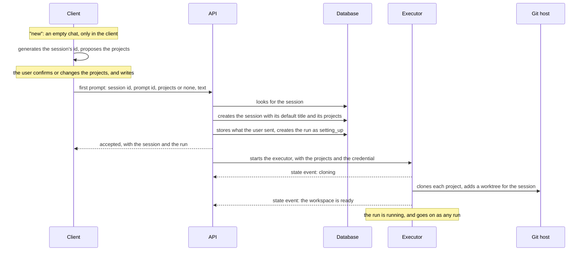

# Create a session and set up its workspace

How a session comes to exist, how it gets its title and its projects, and how its workspace
is prepared. The maintainer closed this flow on 2026-11-15. The terms are in the
[glossary](../glossary.md). None of it is built yet.

A session is not created by a step of its own. It is created by the first prompt sent to it,
and its workspace is prepared by the first run.

## The flow

1. **"New" makes an empty chat in the client.** Nothing reaches the API yet. The client
   generates the id of the session.
2. **The client proposes the projects, and the user confirms or changes them** before
   sending. See [which projects](#which-projects-a-session-works-in).
3. **The first prompt carries everything.** The id of the session, an id for the prompt that
   the client also generates, the projects chosen or an explicit "none", and the text.
4. **The API looks for the session.** There are three cases:
   - it does not exist: the API creates it, and goes on;
   - it exists: the prompt is one more prompt of that session, as in
     [prompt-and-reconnect](prompt-and-reconnect.md);
   - it exists and is deleted: the API rejects the prompt. It neither brings the session
     back nor creates another. This is the case of a device that still shows a session
     another device deleted.
5. **The API gives the session its default title**, stores what the user sent, creates the
   run as `setting_up` and acknowledges.
6. **The executor prepares the workspace.** It clones each project and adds a worktree for
   the session, and says what it is doing with events of state, such as that it is cloning.
7. **The run goes on** as `running`, as in [prompt-and-reconnect](prompt-and-reconnect.md).

## Rules

### Ids come from the client

- **The client generates the id of a session and the id of each prompt.** The API creates
  what it does not find under that id.
- **A prompt sent twice runs once.** A client that does not get the acknowledgement sends
  the prompt again with the same id. The API recognizes it and does not start a second run.
  Without the prompt's id, the retry of a first prompt would look like a second prompt of a
  session that now exists.

### Title

- **A session always has a title.** The API gives it a default one when it creates the
  session: the text of the first prompt, cut short. No model is called for it.
- **The user can rename it, and a title the user set is never replaced.** The session keeps
  a mark that its title is the user's, so nothing automatic changes it later.

### Which projects a session works in

- **Projects are registered in the API.** A project is a name and its remote repository. The
  API clones only registered projects, never a URL it is handed.
- **The user chooses, never the model.** The choice is visible in the new chat before the
  first prompt is sent, and can be changed there.
- **The CLI proposes from the remote, not from the folder.** Started in a folder, it reads
  the URL of the folder's git remote and proposes the registered project with that
  repository. A folder's name is not reliable; its remote names the repository. With no
  match it proposes nothing.
- **The proposal does not bind.** In the folder of one project, the user may choose another:
  open in harness-cli, wanting a change in the harness.
- **More than one project gives a workspace with several roots**, one per project.
- **A mobile has no folder.** The user chooses from the list, and the project used last is
  proposed.
- **"None" is an explicit choice**, for a session that is not about code. The API rejects a
  first prompt that says neither projects nor "none".
- **The workspace is fixed when the session is created.** Work on another project is another
  session.
- **A worktree starts from the repository's default branch.** The CLI may offer the branch
  the folder is on, when the remote has it. Changes in the folder that were not pushed do
  not reach the server, and the CLI says so.

### Preparing the workspace

- **The executor prepares it, inside the run.** The API does not touch the disk. The run is
  `setting_up` meanwhile, and the user sees what is happening through events of state.
- **Every run checks, not only the first.** A run whose session has projects and no
  workspace ready prepares it. So a session whose first run failed while cloning tries again
  with the next prompt, and a workspace that was lost is rebuilt.
- **A failure while preparing ends the run as `failed`.** The session stays, without its
  workspace.
- **It is prepared late on purpose.** Nothing is cloned before a prompt asks for it, since
  the API cannot know when a session will be used, or whether it will.

### Git credentials

- **The API holds the credential and passes it to the executor.**
- **For now it is the maintainer's own account.** A separate git account only for agents is
  the aim, and waits because of its cost.
- **The credential is never written to disk** nor to the git configuration of a worktree.
  The executor uses it only to clone, fetch and push: the commands a model starts run as the
  same user and could read a file.

## Open points

Not decided.

- **How a project is registered.** From a client, or in the server's configuration. It is a
  deliberate step either way, since the credential has to reach that repository.
- **Which credential, while it is the maintainer's account.** A fine-grained personal access
  token limited to the registered repositories, or a GitHub App whose tokens last an hour,
  were proposed to limit what a leaked credential can reach.
- **Whether a session created with "none" can get a project later.** An ask that stops the
  run and asks where to work was considered, and left for later.
- **The name of the branch a worktree is on.** A worktree needs a new branch. What it is
  called, and whether the user can name it, was not discussed.
- **One clone of a repository for all its sessions.** Whether sessions on the same project
  share a clone and add their worktrees to it, and what two first runs that clone at once
  do, was not discussed.
- **What an event of state for the setup carries.** See [events](../design/events.md).
