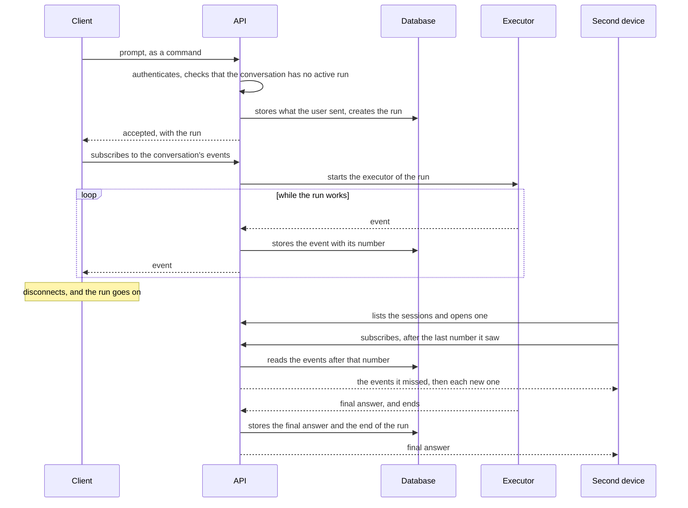

# Send a prompt, execute and reconnect from another device

The central scenario of R02 of [mvp.md](../mvp.md): the user sends a prompt from one device,
that device goes away, the run goes on in the server, and the user picks the conversation up
from a second device. The terms are in the [glossary](../glossary.md). None of it is built
yet.

The flow starts with a session that already exists. Creating a session and setting up its
workspace is a flow of its own, not designed yet; see [the list of flows](README.md).

## The flow

1. **The client sends the prompt as a command.** The API authenticates it, and rejects it as
   busy when the conversation already has a run that is not ended (R05; see the
   [run lifecycle](../design/run-lifecycle.md)).
2. **The API stores and acknowledges.** It stores what the user sent and creates the run. The
   client gets only an acknowledgement, with the run. It does not wait for the run to end.
3. **The client subscribes to the conversation's events.** Everything else arrives through
   that subscription, the final answer included.
4. **The API starts the executor of the run**, as a child process. The executor runs the
   harness and reports each event to the API.
5. **Each event is stored, then delivered.** The API gives the event its number, in order
   within the conversation, stores it, and only then sends it to whoever is subscribed.
6. **The client disconnects and the run goes on.** A disconnection never cancels a run.
7. **A second device lists the sessions, opens one and subscribes**, saying the last number
   it saw. The API sends it the events after that number, and then each new one as it
   happens. A device that has seen nothing gets them all.
8. **The run ends.** The final answer is stored and delivered as one more event.

A device that reconnects after a network failure does the same as the second device in
step 7. There is one mechanism for both.

## What it rests on

- **Commands and events are two channels.** A command, such as sending a prompt, cancelling
  or answering an ask, is a short request that answers at once. What a run produces arrives
  only as events. The device that sent the prompt and one that connects later therefore get
  exactly the same.
- **The record of events is the guarantee, not the delivery.** An event is stored before it
  is delivered, and a client asks for the events after the last number it saw. The API does
  not need to know whether a device received something.
- **The API owns the state.** It is the only writer of the database; the executor talks only
  to the API and the clients keep nothing of their own. See
  [where a run executes](../design/run-lifecycle.md#where-a-run-executes).
- **One order for everything a client shows.** What the user sent and the events share the
  numbering of their conversation. See [events](../design/events.md).
- **The events are the harness's own**, with the few the API adds. See
  [events](../design/events.md).

## Open points

Not decided. Each is an input to the design of the API's contract, which the maintainer left
for later.

- **The transport of the subscription.** Server-sent events were proposed, with plain HTTP
  for the commands: there is no token-by-token output and the commands are few, and a
  server-sent stream reconnects by itself saying the last event it received.
  [harness-api#9](https://github.com/Mikode13/harness-api/issues/9) says resumable SSE too.
  The maintainer also considered sockets and left the choice for later.
- **A key that makes a prompt safe to send twice.** A client that does not get the
  acknowledgement may send the prompt again. A key the client generates, so that the same
  prompt sent twice starts one run, was proposed and is in
  [harness-api#4](https://github.com/Mikode13/harness-api/issues/4).
- **What the conversation keeps of the prompt.** The prompt is what the user writes plus the
  context the product adds. Whether the conversation keeps the whole prompt or only the
  user's text is open in the [glossary](../glossary.md).
- **Who sets up the workspace** before the harness starts working, while the run is
  `setting_up`. It is open in the [run lifecycle](../design/run-lifecycle.md#open-points).
- **The channel between the API and the executor.** Open in the same place.
