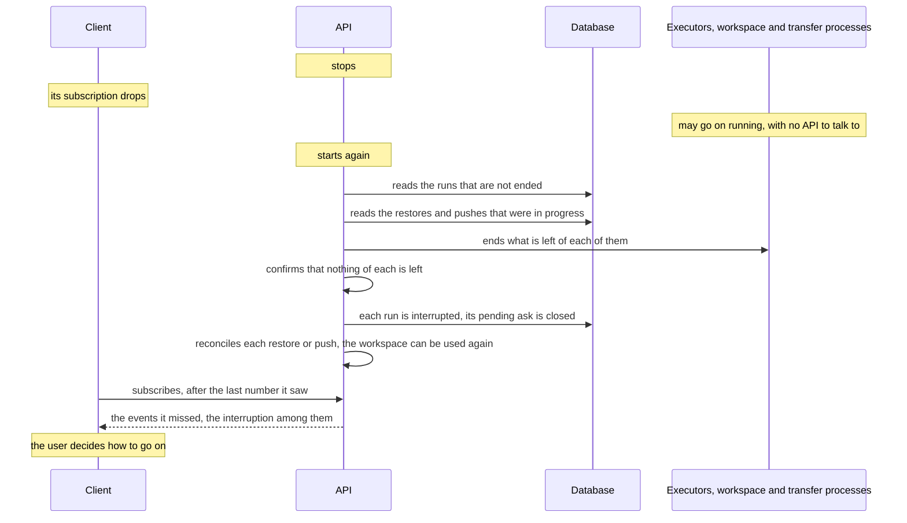

# Restart of the server

R08 of [mvp.md](../mvp.md): what happens to the runs that were working when the API stops,
by a deployment or by a failure, and starts again, and to a restore or a push that was in
progress. The rules were decided on 2026-11-14 and
2026-11-15, in the [run lifecycle](../design/run-lifecycle.md); this document puts them in
order. The terms are in the [glossary](../glossary.md). None of it is built yet.

A run that was working is not resumed and is not run again. It becomes `interrupted`, and
the user decides how to go on.

## The flow

1. **The API stops.** Its clients lose their subscriptions. Its executors and its workspace
   processes do not end with it: each can go on running, and so can a command an executor
   started.
2. **The API starts again and reads the runs that are not ended**: those that were
   `setting_up`, `running`, `waiting_for_input` or `cancelling`.
3. **It also recognizes the restores and the pushes that were in progress.** A workspace
   process restores and pushes outside a run, so it is not among those runs, and it may
   still be writing in a workspace. The API stores each step of a restore or a push before
   it starts its process, so it reads them as it reads the runs.
4. **For each, it ends what is left and confirms that nothing is.** The executor, or the
   workspace process and its transfer process, and every process they started. Until that
   is confirmed the run is not ended and the restore or the push is not over, and the
   workspace takes no work: a prompt is rejected as busy.
5. **Each run becomes `interrupted`, and its pending ask is closed.** The API lost its
   channel to the executor that asked, so an answer could not reach it.
6. **Each restore or push is reconciled**, so that the workspace is in a state the product
   knows and can be used again. The harness finishes a move through its history that its
   process did not finish, with the next move or run. A push is three steps the API
   started one at a time, so it knows which one was cut short; a clean repository left
   behind is removed, never reused. What else a push needs is not decided.
7. **A client that reconnects gets what it missed**, as in
   [prompt-and-reconnect](prompt-and-reconnect.md), and sees that the run was interrupted.
8. **The user decides how to go on.** Nothing is run again by itself: a prompt that had
   started is never replayed, since its tools may already have had effects.

## An executor that dies while the API runs

The API sees the executor's process exit. The rest is the same from step 4: it confirms that
nothing the run started is left, and the run becomes `interrupted`. A workspace process or a
transfer process that dies during a restore or a push is treated the same way, and its work
is reconciled.

## What is left

The messages and the events stored before the restart are kept, and so is the code that
earlier runs completed. The user sees everything up to the last stored event, and at most
one more message that says what happened.

The interrupted run left no snapshot: the next run starts from the last one that was stored,
and its model is told that the earlier run did not complete.

What the interrupted run itself changed stays in the workspace too. Nothing is undone by
itself: the user sees it in the history and decides whether to restore it; see
[what is left after a run that does not complete](../design/run-lifecycle.md#what-is-left-after-a-run-that-does-not-complete).

## Open points

Not decided.

- **What reconciling a push cut short takes**: it may have reached one project and not
  another, and the step that was cut short may have pushed or not. It is an open
  point of the [run lifecycle](../design/run-lifecycle.md#open-points).
- **How the processes of a run are ended and confirmed gone** after a restart, when the API
  no longer holds the executors it started. It is an open point of the
  [run lifecycle](../design/run-lifecycle.md#open-points);
  [learnings](../docs/learnings.md) has what showed the need.
- **What an executor did after it lost the API.** It may have gone on changing files, with
  nobody to report to, so no event tells it. Whether the user is told, and from what, was
  not discussed.
- **Going on from a checkpoint.** R08 allows restoring execution from supported safe
  checkpoints. None is supported yet: resuming a run that waits for an answer depends on
  [harness#136](https://github.com/Mikode13/harness/issues/136).
