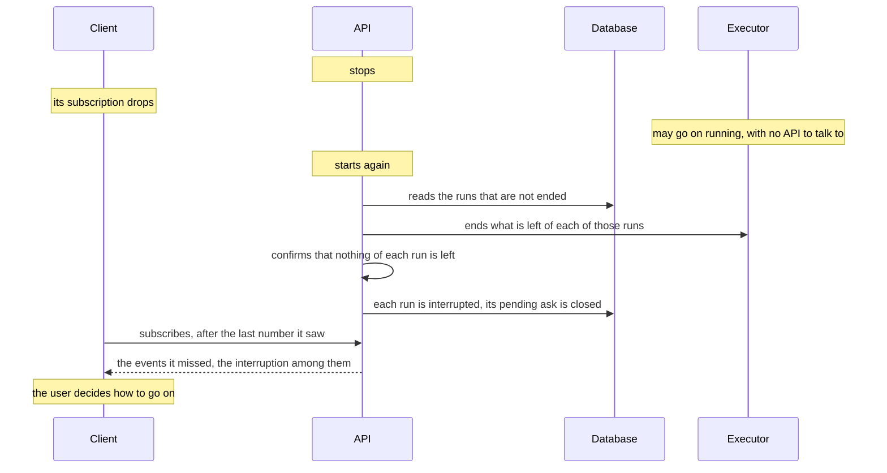

# Restart of the server

R08 of [mvp.md](../mvp.md): what happens to the runs that were working when the API stops,
by a deployment or by a failure, and starts again. The rules were decided on 2026-11-14 and
2026-11-15, in the [run lifecycle](../design/run-lifecycle.md); this document puts them in
order. The terms are in the [glossary](../glossary.md). None of it is built yet.

A run that was working is not resumed and is not run again. It becomes `interrupted`, and
the user decides how to go on.

## The flow

1. **The API stops.** Its clients lose their subscriptions. Its executors do not end with
   it: an executor can go on running, and so can a command an executor started.
2. **The API starts again and reads the runs that are not ended**: those that were
   `setting_up`, `running`, `waiting_for_input` or `cancelling`.
3. **For each, it ends what is left and confirms that nothing is.** The executor and every
   process it started. Until that is confirmed the run is not ended, and neither its
   conversation nor its workspace takes another run: a prompt is rejected as busy.
4. **Each run becomes `interrupted`, and its pending ask is closed.** The API lost its
   channel to the executor that asked, so an answer could not reach it.
5. **A client that reconnects gets what it missed**, as in
   [prompt-and-reconnect](prompt-and-reconnect.md), and sees that the run was interrupted.
6. **The user decides how to go on.** Nothing is run again by itself: a prompt that had
   started is never replayed, since its tools may already have had effects.

## An executor that dies while the API runs

The API sees the executor's process exit. The rest is the same from step 3: it confirms that
nothing the run started is left, and the run becomes `interrupted`.

## What is left

The messages and the events stored before the restart are kept, and so is the code the run
changed. The user sees everything up to the last stored event, and at most one more message
that says what happened.

## Open points

Not decided.

- **How the processes of a run are ended and confirmed gone** after a restart, when the API
  no longer holds the executors it started. It is an open point of the
  [run lifecycle](../design/run-lifecycle.md#open-points);
  [learnings](../docs/learnings.md) has what showed the need.
- **What an executor did after it lost the API.** It may have gone on changing files, with
  nobody to report to, so no event tells it. Whether the user is told, and from what, was
  not discussed.
- **The snapshot of an interrupted run.** It left none. Whether the next run starts from
  the snapshot before it, and what it is told; see
  [prompt-and-reconnect](prompt-and-reconnect.md#open-points).
- **Going on from a checkpoint.** R08 allows restoring execution from supported safe
  checkpoints. None is supported yet: resuming a run that waits for an answer depends on
  [harness#136](https://github.com/Mikode13/harness/issues/136).
