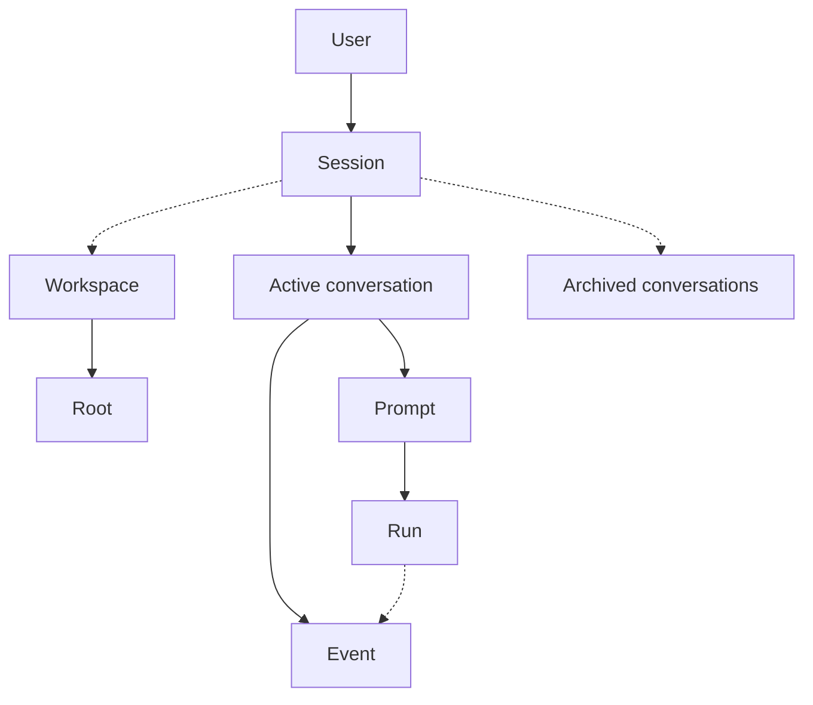

# Glossary

The words the product uses for its parts. The maintainer defined the settled terms on
2026-11-12 and 2026-11-13. [mvp.md](mvp.md) uses them; where an older issue or a harness
type uses the same word for something else, the last section says so.

## How the terms contain each other

A user owns sessions. A session may have a workspace, of one or more roots, and has one active
conversation and any number of archived ones. Each prompt sent in a conversation starts a run,
so a conversation has many runs. Events belong to the conversation, in one order: a run reports
most of them, and some, such as what the user sent, are of no run. The context is not in the
diagram: it is what a run is given from the conversation on a call to the model.

## Settled terms

### User

A person who may use the product: one of a few people the maintainer knows. A user has one
API key and owns a list of sessions. See the constraints in [mvp.md](mvp.md).

### API key

What every request of a user carries, and how the API knows whose it is. Each user has one,
kept as a hash, and the maintainer can disable it. See
[security](design/security.md#an-api-key-for-each-user).

### Session

A reserved space the user keeps and comes back to. It has a title and is where work on one
thing lives. For example, the session for translations, whose workspace is a worktree for
translations.

A session has one workspace, or none when it is not about code. It always has a title: a
default the API gives it, until the user renames it.

A session outlives its conversations: the user can clear it and keep it. What the user
lists, opens, renames and deletes is sessions, not conversations.

It is not the harness's `Session`; see the last section.

### Conversation

The set of messages inside a session: its events, in one order, what the user sends
included. It is always whole: nothing in it is dropped or rewritten to save context. A session
has one active conversation at a time.

It is not the context. The context may summarize the conversation; the conversation stays
whole.

### Clear

Clearing a session archives its current conversation and starts a new, empty one in the
same session. The session, its title and its workspace stay. For example, the session for
translations is cleared to start a different translations task.

Clearing does not delete anything.

### Archived conversation

A conversation that a clear replaced. It is no longer the session's active conversation,
but it still exists and can still be found.

It is not a deleted conversation.

### Deleted

Deletion is logical first; a real purge may come later. Something deleted is no longer
returned by listing, opening or retrieval. For example, a throwaway question such as "what
is the capital of Papua New Guinea" is not worth remembering.

Archived and deleted are two different states: an archived conversation can still be
found, a deleted one cannot.

### Workspace

Where the harness works for a session: one root or several. A workspace of several roots
holds several projects at once, such as the API and the harness together.

It is not a worktree. A worktree is one thing a root can be.

On the server of the MVP, every root is a worktree, so two sessions on the same project
never write in the same folder, as R03 of [mvp.md](mvp.md) requires. Working in a project's
main folder is for local use.

### Project

A name and its remote repository, registered in the API. The user chooses the projects of a
session when it is created, and each becomes a root of its workspace. Only registered
projects are cloned.

It is not a workspace. A project is what can be worked on; a workspace is where one session
works on it.

### Root

One folder of a workspace: a worktree, or a project's main folder with no worktree.

### Worktree

A copy of a repository, and nothing more. It becomes part of a workspace when a session
works in it.

### Prompt

What a run is started with: what the user writes, plus the context the product adds to it,
such as the system prompt and the plans.

It is not only the user's text. What the user writes is one part of the prompt.

### Run

The execution a prompt starts, inside a conversation. A conversation has many runs, one per
prompt, and at most one of them works at a time. A run has a state;
[run-lifecycle.md](design/run-lifecycle.md) defines the states.

### Configuration

A user's agents and workflows, kept so that they are set without code.

### Changed file

A file a run changed. It belongs to the run, so that a client can show what each run did.

### Workspace operation

Work on a session's workspace that the API carries out in steps and stores step by step: the
preparation of a workspace, inside a run that is `setting_up`, or a restore or a push, outside
any run, which holds the workspace as a run does.

### Usage

What a run spent and where its time went, such as in tools, in the model's thinking or in
latency, recorded for the user whose request started it. See
[data-model](design/data-model.md#traceability).

### Executor

The process that runs the harness for one run. The API starts it in the session's sandbox and
is the only one it talks to.

### Sandbox

The container a session's executor and workspace processes run in, with everything a model's
commands start. It sees only its session's workspace, and nothing of the server or of other
sessions. See [security](design/security.md#a-sandbox-for-each-session).

### Workspace process

A process the API starts to work on a session's workspace outside a run's executor: it
prepares the workspace inside a run, before the run's executor starts, and outside any run it
restores code and pushes a branch. It runs in the session's sandbox, talks only to the API, and is
never given the git credential: a clone, a fetch or a push it needs is done by a transfer
process. An operation that needs one has a workspace process before it and another after it.

It is not an executor. An executor runs the harness for a run; a workspace process runs no
agent.

### Transfer process

A process the API starts for one clone, fetch or push, between the workspace process that
gets a clean repository ready and the one that finishes, and the only process that is given
the git credential. It runs git only in a clean repository, outside every sandbox, with no
user or system git configuration and an environment the API sets, and ends when the transfer
does. It runs nothing else: no git command
in a worktree's repository and no agent. See [security](design/security.md#git-credentials).

### Clean repository

A git repository that a workspace process makes for one operation with the git credential and
removes when the operation ends, and that no command a model started has written in. A transfer
process uses the credential only there. The workspace process brings a branch into it from a
worktree's repository to be pushed, and passes on what was downloaded into it to the worktree's
repository. Every git command on it runs with no user or system git configuration and an
environment the API sets, so that nothing a model's command left in the sandbox's home is copied
into it. See [security](design/security.md#git-credentials).

### Event

What a client shows of a conversation, in its order: what the user sent, and what a run
reports, such as a tool's activity, a text answer or an ask, or a change of state. It belongs
to the conversation, and names the run that reported it or the user who wrote it when there
is one. Every event is stored in the database; see [events](design/events.md).

Whether the messages the model needs are kept as a record apart from the events is an open
point below.

### Ask

An event with which a run asks the user something and waits: a question or an approval. A
pending human interaction (R06 of [mvp.md](mvp.md)) is an ask that has not been answered
yet.

### Context

What the agent is given to work with on a call to the model. It is a part of the
conversation, and may summarize it so the agent works better; the conversation itself
stays whole.

It is not the conversation. Compacting or summarizing the context never removes anything
from the conversation.

### Snapshot

What an agent needs to continue from where a run left it, as the harness gives it: the
agent's own record of the conversation, in the harness's format. A run starts from the
snapshot the run before it left, and leaves its own when it ends. The API stores it without
reading it.

It is not the conversation. The conversation is what the user reads; the snapshot is what
the agent continues from. The harness does not offer one yet; see
[design/harness-needs.md](design/harness-needs.md).

## Open points

These are not decided. They are inputs to system design (agenda items in
[mvp.md](mvp.md)), not decisions. Points that were here and are now decided are in
[design/events.md](design/events.md), [flows/ask-and-answer.md](flows/ask-and-answer.md) and
[design/harness-needs.md](design/harness-needs.md): the order and delivery of events, the
user's message in the same order, the answer to an ask, and the harness's conversation stored
as the harness gives it.

- **Stored summaries.** A summary the context uses might be stored, since it costs tokens
  and cannot be reproduced.
- **A name for what the user writes.** The prompt is the user's text plus the context the
  product adds, so the user's text alone has no term of its own yet. Whether the
  conversation keeps the whole prompt or only that text is not decided either.
- **Code history belongs to the session.** The code history, which restores code (R09),
  might belong to the session and its workspace, so that it survives a clear.
- **Terms to name later.** These are named when their flow is designed: agent and workflow
  definitions (R10), a delegated run (R11), memory and plan (R12) and device (R07). The
  flow for R09 is written and still has no term for a point the code is restored to; see
  [flows/changes-and-push.md](flows/changes-and-push.md#open-points).

## Words used elsewhere

This section lists where other documents use a word differently. It records facts and
changes none of those documents. Issue text is as read on 2026-11-13.

### In the harness

Source: the harness's `docs/architecture.md`.

- **`Session`.** The harness gives each agent a `Session` of its own, with an id such as
  `smart-hawk-4821`, and a run records the one it belongs to. It identifies an agent's
  runs; it is not the product's session, which has a title and is what the user lists.
- **`Conversation`.** For `LLMAgent`, a tree of turns whose context is the path to one of
  them. It lives in process as long as the agent, and persisting it waits for a session
  manager. The product's conversation is stored and is the set of messages in a session.
- **Run.** `Agent.run` is a run in the same sense: one execution for one prompt.
- **Workspace and roots.** The harness's `workspace` option is a list of `roots`, each a
  folder with `read` or `write` access, which is the product's workspace and its roots. The
  harness also lets one run write to a workspace at a time.
- **`ProgressEvent`.** The narration a run passes to `onProgress`. The product's event is
  what the API returns and stores, which is not the same type; whether one is built from
  the other is for system design.
- **`ask` and `approve`.** The harness has two callbacks: `ask` answers what an agent asks
  its user, and `approve` is asked before a `destructive` tool call. The product's ask
  covers both a question and an approval.
- **Compaction.** An `LLMAgent` can summarize its context, and the summary goes into the
  run as a `ContextSummaryPart`. The conversation keeps every turn and each call sends
  `compactedContext`, the context from the latest summary on. This matches the product's
  split between conversation and context.
- **History.** In the harness, history is the recovery store of what runs changed in a
  workspace, and `HistoryRun` is one of its runs. The MVP's "visible history" is the
  messages of a conversation.

### In the open issues of harness-api

- **[#1](https://github.com/Mikode13/harness-api/issues/1)** says "conversations and
  durable tasks" and "tasks/attempts", and "open the same conversation on mobile" where
  this vocabulary says session. It says "worktree per session".
- **[#4](https://github.com/Mikode13/harness-api/issues/4)** says "task" where this
  vocabulary says run, and adds an "execution attempt". It has the user create, list and
  reopen conversations, where this vocabulary has sessions. Its task states are queued,
  running, waiting_for_input, completed, failed, cancelled and interrupted; a run's states
  in [design/run-lifecycle.md](design/run-lifecycle.md) have `setting_up` in place of
  "queued", and add `cancelling`. It allows one active execution per
  conversation. It keeps "public conversation IDs distinct from harness session/history
  IDs".
- **[#5](https://github.com/Mikode13/harness-api/issues/5)** says "a session has its own
  worktree", as this vocabulary does. It also says "even if multiple conversations
  reference it" about one workspace; here a session has one active conversation and a
  workspace belongs to the session.
- **[#6](https://github.com/Mikode13/harness-api/issues/6)** says "task" for the unit the
  executor runs, "attempt", "live conversational follow-ups" and "per-conversation/workspace
  exclusion". It names the harness's "ask/approve".
- **[#7](https://github.com/Mikode13/harness-api/issues/7)** says "harness sessions" in its
  title, "restored sessions", and "agent conversation", all for what the harness stores in
  a snapshot; none is the product's session.
- **[#8](https://github.com/Mikode13/harness-api/issues/8)** says "human-request" and
  "request" for what this vocabulary calls an ask, keyed by conversation and attempt.
- **[#9](https://github.com/Mikode13/harness-api/issues/9)** says "application events" with
  an owner, conversation, run and attempt, and "for a task" in an acceptance criterion. It
  keeps "human messages, durable lifecycle/request state and optional activity narration"
  distinct, and calls `ProgressEvent` optional narration. Its ordered replay cursor is the
  ordering proposed in the open points.

### In mvp.md

[mvp.md](mvp.md) was aligned with this glossary on 2026-11-13. R11 says "a task" for what
a parent agent delegates, and "execution" appears where R02 and R03 speak of status and
concurrency; neither is a defined term here.
